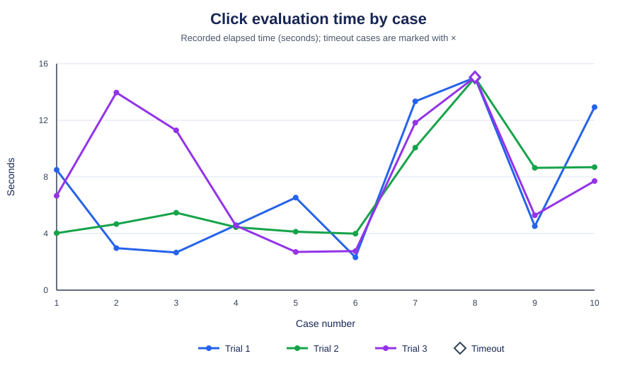

# Clicking Evaluation Sheet

Record one sheet per participant and session. The in-app evaluation presents the ten cases below in order. Start the timer separately for each case. When a target is selected or the 15-second timeout is reached, the timer freezes and the next target appears. The frozen time remains visible until **Start / Next Case** is pressed.

## Session details

| Item | Record |
|---|---|
| Date and time |  |
| Evaluator |  |
| Participant code (no name) |  |
| Device and Android version |  |
| App version / commit |  |
| Calibration completed before this run? |  |
| Lighting and approximate device distance |  |
| Glasses/contacts or other relevant setup notes |  |

## Run the evaluation

1. Start tracking and complete calibration.
2. Open **Click Evaluation** and explain: “For each case, press Start, then look at the target until it is selected. The next target will appear when the timer stops; press Start again to measure it.”
3. Have the participant press **Start / Next Case** for the first case. Do not give hints about where to look after a case begins.
4. After each case, copy its outcome and elapsed time from the frozen timer display. Press **Start / Next Case** to begin timing the next target.
5. After the last case, copy the full result summary. Note interruptions, accidental selections, or anything that could affect the run. Repeat the full sequence for another trial if time allows; make a separate copy of this sheet for each run.

## Case results

The target sizes are the sizes used by the evaluation screen. `Timeout` means no selection occurred within 15 seconds; the app advances automatically and shows the next target while the timeout remains visible. Enter `—` for its time in the table. Mark an interrupted case as invalid in Notes; the app does not currently provide an invalid-case control.

Trial 1
| # | Target | Position | Outcome (`success` / `timeout`) | Time (s) | Notes |
|---:|---|---|---|---:|---|
| 1 | Large | Center | success | 8.50 |  |
| 2 | Small | Center | success|2.97   |  |
| 3 | Large | Top left |success | 2.66  |  |
| 4 | Large | Top right | success| 4.59  |  |
| 5 | Large | Bottom left |success | 6.54  |  |
| 6 | Large | Bottom right |success |2.32   |  |
| 7 | Small | Top left | success| 13.34  |  |
| 8 | Small | Top right | timeout| 15.02  |  |
| 9 | Small | Bottom left |success|4.52    |  |
| 10 | Small | Bottom right |success| 12.93   |  |

Trial 2
| # | Target | Position | Outcome (`success` / `timeout`) | Time (s) | Notes |
|---:|---|---|---|---:|---|
| 1 | Large | Center | success | 4.03 |  |
| 2 | Small | Center | success| 4.67 |  |
| 3 | Large | Top left |success | 5.47  |  |
| 4 | Large | Top right | success| 4.45  |  |
| 5 | Large | Bottom left |success | 4.13  |  |
| 6 | Large | Bottom right |success | 3.99   |  |
| 7 | Small | Top left | success| 10.07  |  |
| 8 | Small | Top right | timeout| 15.02  |  |
| 9 | Small | Bottom left |success| 8.64   |  |
| 10 | Small | Bottom right |success| 8.69   |  |

Trial 3
| # | Target | Position | Outcome (`success` / `timeout`) | Time (s) | Notes |
|---:|---|---|---|---:|---|
| 1 | Large | Center | success | 6.67 |  |
| 2 | Small | Center | success| 13.96 |  |
| 3 | Large | Top left |success | 11.29  |  |
| 4 | Large | Top right | success| 4.56  |  |
| 5 | Large | Bottom left |success | 2.70  |  |
| 6 | Large | Bottom right |success |2.76   |  |
| 7 | Small | Top left | success| 11.83  |  |
| 8 | Small | Top right | timeout| 15.03  |  |
| 9 | Small | Bottom left |success| 5.29   |  |
| 10 | Small | Bottom right |success| 7.71   |  |

## Session summary

- Total attempts: 30 across 3 trials
- Successful selections: 27 / 30 (90%)
- Timeouts: 3 / 30 (10%)
- Fastest / slowest successful selection: 2.32 / 13.96 seconds
- Case 8 (small, top right) timed out in all 3 trials.
- Accidental selections or interruptions:
- General observations:

The chart compares recorded time by case across the three trials. Timeout entries are plotted at their recorded timer value (about 15 seconds) and marked with a diamond. Compare results descriptively; with one participant, treat them as a pilot rather than a general accuracy claim. This screen tests one target at a time, so it does not test choosing between nearby buttons.

## Takeaways

- **Target size:** Large targets averaged **4.98 s** across the 15 recorded attempts; small targets averaged **9.98 s**. The small top-right target timed out in all three trials, which raises the small-target average.
- **Screen location:** Center targets averaged **6.80 s**, compared with **7.65 s** for corner targets. The top corners were slower overall (**9.44 s**) than the bottom corners (**5.85 s**).
- **Case differences:** Large bottom-right was the fastest case on average (**3.02 s**). Small top-right was slowest, with **3/3 timeouts** at approximately 15 seconds.
- **Success:** 27 of 30 attempts succeeded (**90%**). All three timeouts were the small top-right case.
- **Interpretation:** These are descriptive averages from three trials, with timeout attempts counted at their recorded ~15-second limit. They suggest target size and position may affect selection time in this setup, especially for the small top-right target, but more participants and repeated trials are needed to tell whether the pattern generalizes.

## Selection time by case and trial

Each colored line represents one trial. Diamond markers denote timeouts.

