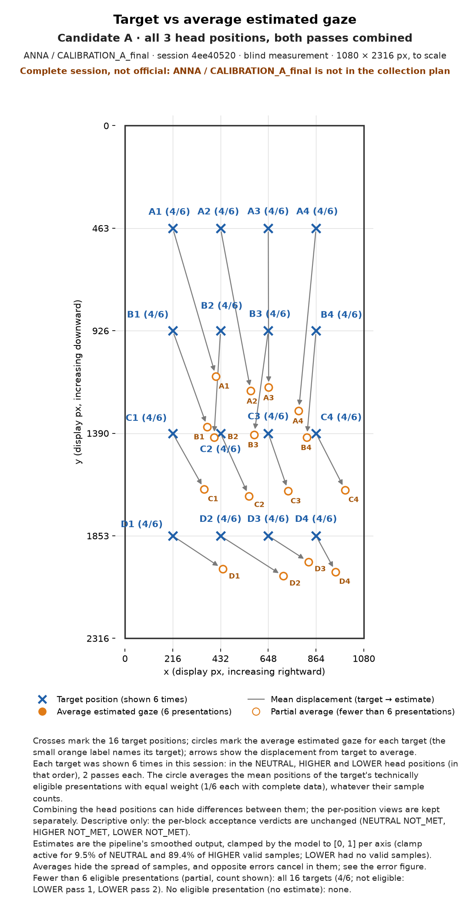
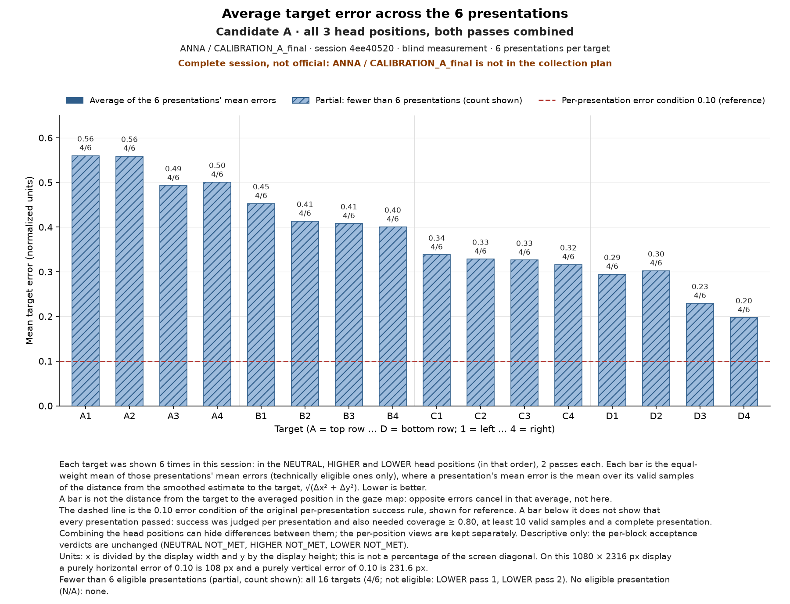

# Calibration comparison — Candidate A: three passes, one head position

| | |
|---|---|
| Candidate ID | `calibration_a_three_pass_static` |
| Branch | `experiment/calibration-a-three-pass` |
| `BASE_SHA` | `e8fa01ef1e397f508aa5a3b3a595539b4ef4490a` (`origin/feature/home-screen`, fetched 2026-11-14) |
| Calibration implementation | `94f1f8c90f09d10763d4a054481888b10f42cd1e` |
| Evaluation integration | `188898b5444015f9d4f07b44dba9c2e323760d7b` |
| Measured build | `f3b224c4801570c57a192d354eb848b30c90b3c3` (evaluation integration plus a home-screen layout fix; `git_dirty_at_build` false; APK SHA-256 `d19ac6cf507a8f1ed67cda0d074879080310d73af99c2581b4fed586b6d58bbc`) |
| Evaluation protocol | `notouch-calibration-comparison-eval` 1.0.0 ([`protocol.json`](protocol.json), SHA-256 of LF bytes `651e4402c8208538ccca1d7e204141315e649c8f15cd3e835f795c689046c547`), log schema 4, snapshot schema 2; unchanged |
| Data | **Final collection:** one complete session, ANNA / `CALIBRATION_A_final` (`eval-20261115T130702Z-4ee40520`, 2026-11-15), **not official** because its recorded label is outside the protocol's collection plan. The earlier exploratory session is kept separately and never combined with it ([archived write-up](archive/exploratory_ANNA_CALIBRATION_A_761b3d19/README.md)). |
| Result | **NOT_MET in all three head-position blocks.** NEUTRAL met every tracking criterion but not accuracy (2/32 successful, p95 error 0.447). HIGHER failed accuracy by a wide margin (p95 0.840; estimates held at the bottom screen edge). LOWER produced **no valid measurement sample**: the face stayed outside the model's validity range, so availability and sample rate failed and the spatial criteria had insufficient data. |
| Evidence level | Preliminary: one participant, one phone, one session, one calibration, not official. Candidate B has not been measured; no calibration method is declared better. |

## 1. Purpose and candidate A calibration method

The Iteration 3 evaluation of the nine-point home-screen calibration missed its accuracy targets, mostly through a
systematic offset. This experiment asks: with the same amount of calibration data, 27 anchors, is it better to repeat
the calibration in one head position (**candidate A**) or to spread it over several head positions (candidate B)? This
report is the A half; it cannot rank A against B.

**Calibration (candidate A, unchanged since `94f1f8c`).** The existing nine targets (x, y ∈ {0.15, 0.5, 0.85}) are shown
three times while the participant keeps one front-facing head position, giving 27 anchors, and `GazeModel.fit` runs
once on all of them in collection order. Per point, unchanged from `BASE_SHA`: 1,000 ms settling; at least 22 accepted
samples and 2,500 ms; the per-feature median; samples 0–250 ms old with quality TRACKING or OUT_OF_RANGE; a face shift
greater than 0.045 from the point median restarts the point; more than 9,000 ms fails the calibration. Breaks: 2 s
after the 4th point of each pass and 3 s after passes 1 and 2.

**Unchanged from `BASE_SHA`.** Feature extraction (`LandmarkFeatures`), eye-state detection, the model (per screen axis,
a linear regression on the two standardized iris features; the logged face position and scale are used only as a
validity gate: a frame is rejected if its face is more than 0.12 from the calibration reference in x or y, or its scale
outside 0.72–1.28 of it), smoothing (`GazePipeline`, factor 0.28), coordinates and interaction rules. Tests require
fit, prediction, feature extraction and the per-point median to equal frozen copies from `BASE_SHA` bit for bit.

## 2. Evaluation procedure, conditions and metrics

One fresh, successful calibration, then one session of three head-position blocks with the **same model** throughout
(no recalibration, model change or tracking stop between blocks).

| | |
|---|---|
| Blocks | NEUTRAL (기본 위치), HIGHER (조금 높은 위치, slightly higher), LOWER (조금 낮은 위치, slightly lower); positions are instructed, not measured |
| Each block | 16 targets at x, y ∈ {0.2, 0.4, 0.6, 0.8}; pass 1 in serpentine order, pass 2 in reverse; 32 presentations of 1.0 s settling + 1.5 s measurement (80 s) |
| Before each block | A preparation screen naming the position, an operator tap on **준비 완료** (Ready), then a 3 s countdown; neither counts toward any metric |
| Pipeline | Smoothing reset at the session start and at every block start; blind mode: no pointer, gaze clicks, scrolling and dictation suppressed |
| Planned sessions | ANNA / A1 (`nhl`) and ANNA / A2 (`lhn`) are the official candidate A sessions; PILOT01 / T1 is a technical pilot |
| Recorded | ANNA / `CALIBRATION_A_final`, order `nhl` (NEUTRAL → HIGHER → LOWER) |

**Declared conditions of the final session** (entered by the operator before the session): eye–screen distance
20.0 cm; lighting "room with normal light"; no glasses; head-position markers "-" (none written); no notes. Every
declared field, including the lighting text, is word for word the one declared for the exploratory session. The
operator reports that this collection was recorded under different lighting from the exploratory one, but the change
is not captured in the declared conditions (source, direction and brightness are not recorded), so this report does
not describe the lighting further or analyse its effect.

**Metrics and thresholds** (from the committed analyzer `tools/analyze_calibration_eval.py` and the protocol, unchanged
after the data were seen). The measured coordinate is the pipeline's **smoothed output, clamped to [0, 1] per axis by
the model**. Spatial values are normalized: x divided by the display width, y by the display height (on this
1080 × 2316 px display 0.10 is 108 px horizontally or 231.6 px vertically), not percentages of the diagonal.

| Criterion, per 80 s block | Definition | Target |
|---|---|---|
| Presentation success rate | Successful presentations / 32. Success = complete, ≥ 10 valid samples, valid coverage ≥ 0.80 and mean sample error ≤ 0.10 | ≥ 0.80 |
| p95 error | Nearest-rank p95 of presentation mean errors over technically eligible presentations (complete, ≥ 10 valid samples, coverage ≥ 0.5); INSUFFICIENT_DATA if fewer than 26 are eligible | ≤ 0.20 |
| Jitter | Mean over eligible presentations of the RMS distance of valid samples from their centroid (INSUFFICIENT_DATA as above) | ≤ 0.05 |
| Availability | Valid / all measurement-phase attempts | ≥ 0.90 |
| Valid samples per second | Valid measurement samples / 48 s | ≥ 10 /s |
| p95 processing latency | Nearest-rank p95 from frame acceptance to publication, over all settling and measurement attempts | ≤ 200 ms |

A block is MET only if all six criteria are MET; a session is MET only if all three blocks are MET. Blocks are reported
separately; percentiles are never averaged and no pooled metric replaces a criterion.

## 3. Recordings and results

### 3.1 Recording inventory

All recordings on the phone were exported read-only on 2026-11-15 at 13:14:03 UTC and left on the phone (archive outside
the repository: `C:\Users\user\Desktop\calibartion\phone-exports\final-collection-20261115T131403Z\export-20261115T131403Z.tar`,
SHA-256 `96fba9ccbc84dae7c28b8f404ad0b095ffada05aafd6edce38eb10fa73cda72a`). A confirmation export at 14:04:06 UTC
(`C:\Users\user\Desktop\calibartion\phone-exports\final-collection-recheck-20261115T140405Z\export-20261115T140406Z.tar`)
is byte-identical to it (same SHA-256), and a read-only listing of the app's evaluation folder showed only the two
session folders below. Sessions are identified by session ID and metadata, never by label.

| Session ID | Participant / recorded label | Recorded (UTC) | State | Official | Use |
|---|---|---|---|---|---|
| `eval-20261115T130702Z-4ee40520` | ANNA / `CALIBRATION_A_final` | 13:07:02–13:11:31 | complete: 3/3 blocks, 96/96 presentations | **no**: ANNA / `CALIBRATION_A_final` is not in the collection plan (only A1 and A2 are). Its block order matches the planned A1 order | **Selected** (final collection) |
| `eval-20261115T093800Z-761b3d19` | ANNA / `CALIBRATION_A` | 09:38:00–09:43:23 | complete | no (label outside the plan) | Exploratory collection: excluded from this scope by collection, not by results; kept as draft evidence ([archived write-up](archive/exploratory_ANNA_CALIBRATION_A_761b3d19/README.md)) |

**Official sessions (A1, A2):** none recorded. **Incomplete or interrupted sessions:** none (the export held no
unfinalized or temporary files). **Technical pilots:** none. Labels are kept exactly as recorded and the protocol is not
changed, so every result below is non-official. The selection rule was fixed from metadata, device checksums and the
import result before any metric was computed: every complete, checksum-verified, blind-mode, clean-build candidate A
session of the final collection, whatever its accuracy ([`data/analysis-inputs-final.json`](data/analysis-inputs-final.json)).

| Selected session | Value |
|---|---|
| Start / end (UTC) | 2026-11-15 13:07:02.256 / 13:11:31.481 (269.2 s); state `complete`, end reason `completed`, blind measurement |
| Build | `f3b224c4801570c57a192d354eb848b30c90b3c3`, dirty flag `false`, descends from `BASE_SHA` |
| Calibration | `calibration_a_three_pass_static`, serial 3, 27 anchors (pass 1–3 × point 1–9, all "same" position), 0 movement retries, 89.2 s, inputs SHA-256 `c0ad406e…0f4bb4bc`, refit verified, no earlier session on it, 37.8 s old at session start |
| Protocol / schemas | `notouch-calibration-comparison-eval` 1.0.0 (hash matches), log schema 4, snapshot schema 2, pipeline `home_screen_gaze_pipeline_e8fa01e` |
| Device / display | Samsung SM-S918N, Android 16; 1080 × 2316 px, rotation 0 (calibration, evaluation and overlay views full screen) |
| Block timeline | NEUTRAL, HIGHER and LOWER start 45.3 s, 132.9 s and 226.9 s after calibration; preparation 4.5 s, 4.6 s and 11.0 s |

### 3.2 Data checks

| Check | Result |
|---|---|
| Checksums | `SHA256SUMS` written on the phone verifies in both exports and after the byte-for-byte import into `data/raw/`; every file of both sessions is identical across the two exports and `data/raw/`, and re-importing the confirmation export is a no-op; the exploratory session's 5 files are also identical to its original 09:49:43 UTC export |
| Frozen inputs | The previous list [`data/raw-inputs.sha256`](data/raw-inputs.sha256) is kept unchanged and still matches: 0 files missing or changed (it reports the 5 new files as added later). New list for this scope, written after the import and before analysis: [`data/raw-inputs-final.sha256`](data/raw-inputs-final.sha256) (10 files, both sessions); it still matches after analysis and plotting |
| Identity | Candidate, recorded build, protocol hash, pipeline variant, schema versions and display geometry as declared; block order `nhl`, 3 blocks × 32 presentations; model snapshot with 27 anchors labelled pass 1–3 × point 1–9 in collection order |
| Accounting | 3,109 attempts accepted = recorded = written, 0 rows lost; preparation 232, countdown 105, settling 1,116, measurement 1,656; all 3,109 processed, 0 discarded, 0 processing errors; 4 pipeline resets (session start + 3 block starts); 2 results in flight before the session start dropped as designed; pointer never drawn |
| Analyzer integrity | 0 integrity errors, 0 issues, 0 unassigned rows; 32/32 complete presentations per block; technically eligible 32, 32 and **0** (LOWER) |
| Exact replay | The Kotlin replay at the recorded build refit all 27 anchors in recorded order to bit-identical parameters and re-ran `GazePipeline.process`: 3,109 processed attempts, **0 mismatches** (exact strings), 4 resets ([replay report](data/derived-final/replay/calibration_a_three_pass_static/ANNA/eval-20261115T130702Z-4ee40520/replay_report.json)); rerunning it reproduces the report byte for byte |

### 3.3 Results

| Session | Pose | Success | p95 error | Jitter | Availability | Valid samples/s | p95 latency | Verdict |
|---|---|---|---|---|---|---|---|---|
| `4ee40520` (not official) | NEUTRAL (block 1) | 2/32 (0.0625) ✗ | 0.447 ✗ | 0.036 ✓ | 0.996 ✓ | 11.5 ✓ | 58.7 ms ✓ | NOT_MET |
| `4ee40520` (not official) | HIGHER (block 2) | 0/32 (0.000) ✗ | 0.840 ✗ | 0.022 ✓ | 1.000 ✓ | 11.6 ✓ | 58.5 ms ✓ | NOT_MET |
| `4ee40520` (not official) | LOWER (block 3) | 0/32 (0.000) ✗ | insufficient data (0 eligible < 26) | insufficient data | 0.000 ✗ | 0.0 ✗ | 58.0 ms ✓ | NOT_MET |
| Target | | ≥ 0.80 | ≤ 0.20 | ≤ 0.05 | ≥ 0.90 | ≥ 10 | ≤ 200 ms | |

**Session verdict: NOT_MET** (not met in NEUTRAL, HIGHER and LOWER). The session is not official.

Supporting values (descriptive, equal weight per presentation; NEUTRAL / HIGHER; LOWER has no valid sample): mean
presentation error 0.205 / 0.560; mean horizontal bias +0.045 / +0.135; mean vertical bias −0.145 / +0.495 (positive =
estimate right of or below the target); model clamp active for 9.5% / 89.4% of valid measurement samples. In NEUTRAL and
HIGHER every presentation had at least 16 valid samples and coverage of at least 0.89, so all 62 unsuccessful
presentations there failed on the error condition alone; all 32 LOWER presentations had 0 valid samples.

Complete numerical outputs (generated; never edited by hand) in [`data/derived-final/`](data/derived-final/README.md):
[`report.md`](data/derived-final/report.md) ·
[`summary.json`](data/derived-final/summary.json) (everything, unrounded) ·
[`sessions.csv`](data/derived-final/sessions.csv) ·
[`blocks.csv`](data/derived-final/blocks.csv) ·
[`presentations.csv`](data/derived-final/presentations.csv) ·
descriptive diagnostics `diagnostic_*.csv` (region and pass, pass comparison, clamp edges, axis gain, face position by
block, calibration anchors and summary) · plotted values in
[`target_summary.csv`](figures/final/ANNA_CALIBRATION_A_final_4ee40520/target_summary.csv) with
[`figures-manifest.json`](figures/final/ANNA_CALIBRATION_A_final_4ee40520/figures-manifest.json).

## 4. Figures

Two summary figures for the selected session ([`figures/final/`](figures/README.md)). Per target, they combine every
technically eligible presentation of the session's three blocks and two passes, matched by grid position:

- **Target vs average estimated gaze.** The screen to scale (x right, y down). Blue crosses are the 16 targets; circles
  are the equal-weight mean of the contributing presentations' mean positions; arrows go from target to average.
- **Average target error.** One bar per target: the equal-weight mean of the contributing presentations' mean sample
  errors (not the distance from target to averaged position, in which opposite errors would cancel). The dashed 0.10
  line is the per-presentation error condition, for reference only.

**Read them with care for this session.** LOWER contributed nothing, so every target is marked partial (4/6: NEUTRAL
and HIGHER passes 1 and 2). Those two blocks had opposite vertical offsets (NEUTRAL above the targets, HIGHER at the
bottom edge), so for rows A–C the nearest of the four presentation means behind each circle is 0.27–0.50 away from
it: the circle marks a position where the estimates did not actually fall. Likewise each bar mixes small NEUTRAL errors
with large HIGHER errors. Both figures are descriptive; the per-block results in 3.3 and the analysis in 5 are the
basis for any conclusion.

### Session ANNA / CALIBRATION_A_final (`eval-20261115T130702Z-4ee40520`, not official)

<a href="figures/final/ANNA_CALIBRATION_A_final_4ee40520/cand_a_anna_calibration_a_final_4ee40520_all_poses_gaze_map.svg"></a>

[](figures/final/ANNA_CALIBRATION_A_final_4ee40520/cand_a_anna_calibration_a_final_4ee40520_all_poses_target_error.svg)

## 5. Analysis

All statements describe one non-official session. Section 5.1 reports measurements; 5.2 lists possible explanations,
none of which is established.

### 5.1 Observations

**Criteria.** Latency (p95 57.98–58.73 ms) met its target in every block. Availability, sample rate and jitter met
theirs in NEUTRAL and HIGHER and failed or could not be computed in LOWER. Accuracy failed everywhere: 2 of 96
presentations succeeded, both NEUTRAL D1 (mean errors 0.090 and 0.097).

**Head position dominated the result.** The logged face position (image-normalized median, relative to the calibration
reference face_x 0.517, face_y 0.765, scale 0.204) was as follows. NEUTRAL and HIGHER are the valid measurement samples
in [`diagnostic_face_by_block.csv`](data/derived-final/diagnostic_face_by_block.csv). That table summarises valid
samples only, so the LOWER row is computed directly from the raw `attempts.csv`: all 546 LOWER measurement attempts
with face features, with min–max in brackets.

| Block | face_y shift | face_x shift | Scale | Valid measurement samples |
|---|---|---|---|---|
| NEUTRAL | +0.017 | −0.010 | ×1.00 | 550 of 552 |
| HIGHER | −0.089 (face higher in the image) | +0.018 | ×0.98 | 557 of 557 |
| LOWER | +0.161 (range +0.123 to +0.168) | +0.004 | ×1.10 | 0 of 547 |

Relative to NEUTRAL, the face moved up by 0.106 in HIGHER and down by 0.144 in LOWER. In LOWER, 546 of 547 measurement
attempts (and 370 of 374 settling attempts) were rejected as `face_y_shift_gt_0.12`, the model's validity gate; one was
a blink. The shift was +0.119 during the countdown and grew to about +0.16 once the targets started. All 980
out-of-range attempts of the session happened in LOWER (946) or in HIGHER's preparation and countdown (34).

**NEUTRAL: an upward and partly horizontal offset.** Estimates lay above the targets (mean vertical bias −0.145, about
337 px) and slightly right (+0.045, about 48 px). The distance from target to presentation centroid averages 0.202,
almost the whole mean error (0.205), while jitter is 0.036: the error is a systematic displacement, not scatter. Error
fell from the top row to the bottom row (rows A–D: 0.255, 0.223, 0.197, 0.146) and from left to right (columns 1–4:
0.233, 0.225, 0.184, 0.179). The pattern was roughly unscaled (slope of centroid on target: x 0.81, y 1.13).

**NEUTRAL: pass 2 was clearly worse than pass 1.** Mean error 0.154 in pass 1 against 0.257 in pass 2, higher in pass 2
for 15 of 16 targets; all 16 pass-1 presentations had a mean error of 0.20 or less, against 3 in pass 2. Pass 2 shifted
right (horizontal bias −0.037 → +0.126) and further up (vertical −0.113 → −0.178), pushing row A against the top edge
(71% of its pass-2 samples clamped). The logged face position did not change between the passes (face_y shift +0.015
and +0.019). Pass 2 starts 40 s later and shows the targets in reverse order, so time and order are confounded.

**HIGHER: estimates held at the bottom edge.** With the face 0.089 above the calibration reference, the model's linear
vertical output averaged 1.17 (NEUTRAL: 0.34), i.e. below the screen; 498 of 557 valid samples (89.4%) were clamped at
the bottom edge (32 of them also at the right edge). The measured vertical position therefore barely followed the
target (slope 0.03; the unclamped output's slope was 0.56), and the vertical bias by row (0.78, 0.60, 0.40, 0.20 for
rows A–D) is nearly the full distance from the row to the bottom edge (0.8, 0.6, 0.4, 0.2). Error by row: 0.802, 0.614, 0.458, 0.366. Horizontal bias
was +0.135 (about 146 px right). The low jitter (0.022) partly reflects the clamp, which fixes y at the edge.

**Clamping.** The clamp lowers measured errors: the analyzer's mean error of the unclamped linear output was 0.215
(NEUTRAL) and 0.714 (HIGHER) against 0.205 and 0.560 for the measured coordinate. It cannot explain the failures, but
it hides most of HIGHER's offset and flattens its pattern.

**Calibration context** (descriptive, [`diagnostic_calibration_summary.csv`](data/derived-final/diagnostic_calibration_summary.csv)).
The face stayed nearly still across the three calibration passes (face_y 0.761, 0.765, 0.769; scale 0.205–0.204; 0
restarts). The vertical iris feature separated the calibration rows by 0.024 (row means −0.077, −0.064, −0.054); the
three passes differed by at most 0.0073 at single targets (centre), 0.0034 or less elsewhere. The fit moves the
vertical output by 28.8 screen heights per unit of the vertical feature; the horizontal output depends mainly on the
horizontal feature (−21.7 per unit, −3.6 per unit of the vertical one). The fit's RMS residual on its own anchors is
0.112 (a calibration diagnostic, not gaze accuracy).

**Compared with the exploratory session** (different calibration and session; facts only). There, estimates lay
**below** the targets in all three blocks (NEUTRAL vertical bias +0.255) and every block had complete data. Here,
NEUTRAL estimates lay above the targets, HIGHER at the bottom edge and LOWER produced no data. The earlier observation
of a consistent downward offset is therefore not reproduced. The logged face scale at calibration was 0.204 here and
0.265 there, with the same declared distance of 20 cm, and the instructed displacements were larger here (up 0.106,
down 0.144 relative to NEUTRAL, against up 0.032 and down 0.100).

### 5.2 Possible explanations (not established)

1. **Head position enters through the iris features.** The model maps only iris features to the screen; face position
   is used only as a validity gate. A head displacement with the eyes on the same target changes those features, which
   would move the estimate: consistent with HIGHER's large downward shift. One session cannot show that this is the
   mechanism, and true eye direction was not measured.
2. **Size of the instructed displacements.** "Slightly higher/lower" was not specified physically and no markers were
   written down; the displacements in this session were large enough to put LOWER outside the 0.12 validity range. This
   explains the missing LOWER data mechanically, but not why the participant moved further than before.
3. **NEUTRAL pass 2.** Time since calibration, reversed target order or a change in gaze behaviour could each explain the
   worse pass 2; the logged face position rules out a large head movement but nothing else.
4. **Framing and distance.** The smaller face scale than in the exploratory session suggests the face was farther from
   the camera or framed differently, while the declared distance was the same; distance was not measured independently.
5. **Lighting.** The operator reports different lighting from the exploratory session, but the recording does not
   describe it, so its effect cannot be assessed. The two sessions also differ in calibration, framing and the size of
   the head displacements, so this collection alone cannot attribute any difference to lighting.

The failures are not explained by latency, processing errors, a visible pointer or logging loss: all were controlled or
met.

## 6. Known limitations and next steps

- **Sample size and status.** One participant, one phone (SM-S918N), one session and one calibration; the session is
  not official (label `CALIBRATION_A_final` outside the collection plan), and the reversed order (A2, `lhn`) was not
  recorded.
- **LOWER has no data.** Its NOT_MET verdict reflects unavailability, not measured accuracy; nothing is known about
  candidate A's accuracy in that position from this session.
- **Head positions** were instructed, not measured; only image-normalized face position is logged.
- **Order and time.** One fixed order (`nhl`): position is confounded with time since calibration; pass 2 is later and
  reversed.
- **Conditions.** Declared distance 20 cm (outside the 30–50 cm the home screen recommends), not measured; lighting
  declared in the same words as before, with no description of the reported change.
- **Reference and coordinate.** Errors are measured against instructed fixation targets, and the measured coordinate is
  clamped to the screen, which caps errors near the edges.
- **Summary figures** combine positions with opposite offsets; they are descriptive only.
- **Candidate B** has not been measured; no comparison or winner is implied.

Focused next steps:

1. Record the planned official sessions **A1 (`nhl`) and A2 (`lhn`)** with the presets' labels; A2's reversed order
   separates position from time.
2. Before that collection, fix in writing (not after seeing data) how far "slightly higher/lower" should go, mark it
   physically, measure the eye–screen distance and describe the lighting concretely (source, direction) in the declared
   conditions. Check the logged face shift after each session (`diagnostic_face_by_block.csv`).
3. Port the evaluation to candidate B and record B1 and B2 under the same conditions before any comparison.

## 7. Reproduction

### 7.1 Environment

- Windows 11, PowerShell, from the repository root. Python 3.14 with the standard library for the analyzer, data,
  diagnostics and test tools; matplotlib 3.11.2 with numpy 2.5.4 for figures only
  ([`tools/requirements-plot.txt`](tools/requirements-plot.txt)).
- Kotlin replay: a JDK 17 or 21 set in the current shell only (`$env:JAVA_HOME`), Gradle wrapper 8.13, Android SDK path
  in the ignored `local.properties`, on a checkout of the recording's `build.git_commit` (`f3b224c…`, this branch's head
  when analysed; no APK is built or installed).
- Phone export: Android platform tools (`adb`) and the installed debug build (`run-as`).

### 7.2 Inputs and outputs

| What | Final collection | Exploratory collection (kept unchanged) |
|---|---|---|
| Export archive (outside the repository) | `C:\Users\user\Desktop\calibartion\phone-exports\final-collection-20261115T131403Z\export-20261115T131403Z.tar` (+ `.sha256`; imported). Byte-identical confirmation export: `C:\Users\user\Desktop\calibartion\phone-exports\final-collection-recheck-20261115T140405Z\export-20261115T140406Z.tar` | `C:\Users\user\Desktop\calibartion\phone-exports\export-20261115T094943Z.tar` |
| Raw sessions (byte-exact) | [`data/raw/`](data/raw/README.md)`calibration_a_three_pass_static/ANNA/eval-20261115T130702Z-4ee40520/` | `data/raw/calibration_a_three_pass_static/ANNA/eval-20261115T093800Z-761b3d19/` |
| Frozen raw-input list | [`data/raw-inputs-final.sha256`](data/raw-inputs-final.sha256) | [`data/raw-inputs.sha256`](data/raw-inputs.sha256) |
| Selection manifest | [`data/analysis-inputs-final.json`](data/analysis-inputs-final.json) | [`data/analysis-inputs.json`](data/analysis-inputs.json) |
| Analyzer, replay and diagnostic outputs | [`data/derived-final/`](data/derived-final/README.md) | [`data/derived/`](data/derived/README.md) |
| Figures | [`figures/final/ANNA_CALIBRATION_A_final_4ee40520/`](figures/final/ANNA_CALIBRATION_A_final_4ee40520/) | [`figures/draft/ANNA_CALIBRATION_A_761b3d19/`](figures/draft/ANNA_CALIBRATION_A_761b3d19/); per-position views in [`figures/archive/`](figures/archive/ANNA_CALIBRATION_A_761b3d19_by_pose/README.md) |
| Write-up | this file | [`archive/exploratory_ANNA_CALIBRATION_A_761b3d19/README.md`](archive/exploratory_ANNA_CALIBRATION_A_761b3d19/README.md) |

Tools in [`tools/`](tools/): `calib_eval_data.py` (export, verify, import, freeze, check-frozen),
`analyze_calibration_eval.py`, `calib_eval_figures.py` (1.1.1), `calib_eval_diagnostics.py`, tests `test_*.py`.
Technical pilots and staging: [`data/pilot/`](data/pilot/README.md), [`data/incoming/`](data/incoming/README.md)
(Git-ignored).

### 7.3 Commands

```powershell
# Export every recording read-only (archive and checksum kept outside the repository), then import byte for byte
# (never overwrites; re-importing identical files is a no-op).
python -B docs\calibration-comparison\tools\calib_eval_data.py export --adb "$env:LOCALAPPDATA\Android\Sdk\platform-tools\adb.exe" --serial R3CW80G6PGW --out <new folder outside the repository>
python -B docs\calibration-comparison\tools\calib_eval_data.py import C:\Users\user\Desktop\calibartion\phone-exports\final-collection-20261115T131403Z\export-20261115T131403Z\files\evaluation\calibration-comparison\ANNA --raw docs\calibration-comparison\data\raw

# Integrity: device checksums and the frozen lists. The final list was written once, after the import and before
# analysis, with: calib_eval_data.py freeze docs\calibration-comparison\data\raw --out docs\calibration-comparison\data\raw-inputs-final.sha256
# (do not rerun freeze: it would overwrite the list). The exploratory list reports only the 5 later-added files.
python -B docs\calibration-comparison\tools\calib_eval_data.py verify docs\calibration-comparison\data\raw
python -B docs\calibration-comparison\tools\calib_eval_data.py check-frozen docs\calibration-comparison\data\raw docs\calibration-comparison\data\raw-inputs-final.sha256
python -B docs\calibration-comparison\tools\calib_eval_data.py check-frozen docs\calibration-comparison\data\raw docs\calibration-comparison\data\raw-inputs.sha256

# Exact numerical replay with the app's own GazeModel.fit / GazePipeline.process (JVM unit test at the recorded build).
$env:JAVA_HOME = "<path to JDK 17 or 21>"   # this shell only
.\gradlew.bat :app:testDebugUnitTest --tests dev.gazedot.EvaluationReplayRunner -PgazeReplaySession=docs/calibration-comparison/data/raw/calibration_a_three_pass_static/ANNA/eval-20261115T130702Z-4ee40520 -PgazeReplayOut=docs/calibration-comparison/data/derived-final/replay

# Metrics (selection by session ID), the two summary figures and the descriptive diagnostics.
python -B docs\calibration-comparison\tools\analyze_calibration_eval.py docs\calibration-comparison\data\raw --out docs\calibration-comparison\data\derived-final --selection docs\calibration-comparison\data\analysis-inputs-final.json --source-label "ANNA CALIBRATION_A_final eval-20261115T130702Z-4ee40520 (complete, not official), build f3b224c4801570c57a192d354eb848b30c90b3c3, selection analysis-inputs-final.json"
python -B docs\calibration-comparison\tools\calib_eval_figures.py --summary docs\calibration-comparison\data\derived-final\summary.json --selection docs\calibration-comparison\data\analysis-inputs-final.json --figures docs\calibration-comparison\figures\final
#   (one folder per selected session; refuses to overwrite a folder with different figures unless --replace is given)
python -B docs\calibration-comparison\tools\calib_eval_diagnostics.py --summary docs\calibration-comparison\data\derived-final\summary.json --selection docs\calibration-comparison\data\analysis-inputs-final.json --raw docs\calibration-comparison\data\raw --derived docs\calibration-comparison\data\derived-final

# Tool tests (synthetic data only, plus checks that read the repository's selection manifests and frozen lists).
python -B -m unittest discover -s docs\calibration-comparison\tools -v
```

On 2026-11-15 these commands produced the outputs above; rerunning the replay, analyzer, diagnostics and figures
reproduced every file byte for byte, and the 74 Python tests passed (analyzer 34, data tool 8, figures 27,
diagnostics 5). The exploratory outputs are reproduced with the commands in its
[archived write-up](archive/exploratory_ANNA_CALIBRATION_A_761b3d19/README.md).

### 7.4 Collecting another compatible session

1. Install the debug build of this branch, fix the phone on its stand in portrait orientation, tap **카메라 시작**
   (Start camera) and complete the permission steps. Measure the eye–screen distance at the neutral position.
2. Tap **보정 시작** (Start calibration) and complete all three passes until "보정 완료" (calibration complete) appears.
3. Press Back, tap **설정 · 개발자 기능**, then **시선 정확도 평가 · 보정 비교 (개발용)**. The status must read
   "새 보정: 준비됨 · 27점" and "평가를 시작할 수 있습니다."
4. Choose a preset (**ANNA · A1 · 기본 → 위 → 아래** or **ANNA · A2 · 아래 → 위 → 기본**; **PILOT01 · T1** for a technical
   pilot); only the presets' labels make a session official. Fill in 눈–화면 거리, 조명, 안경 and **자세 기준 메모**, keep
   **블라인드 측정 (기본)** and tap **평가 시작**.
5. For each block the participant takes the position shown, the operator taps **준비 완료**, a 3 s countdown follows,
   then 32 dots (80 s). Back, leaving the screen, screen-off or stopping tracking ends the session as incomplete.
6. Export and import as in 7.3, write a new selection manifest, frozen list, derived folder and figure folder for the
   new scope (never edit the existing ones), and record any excluded or incomplete session with its reason.
