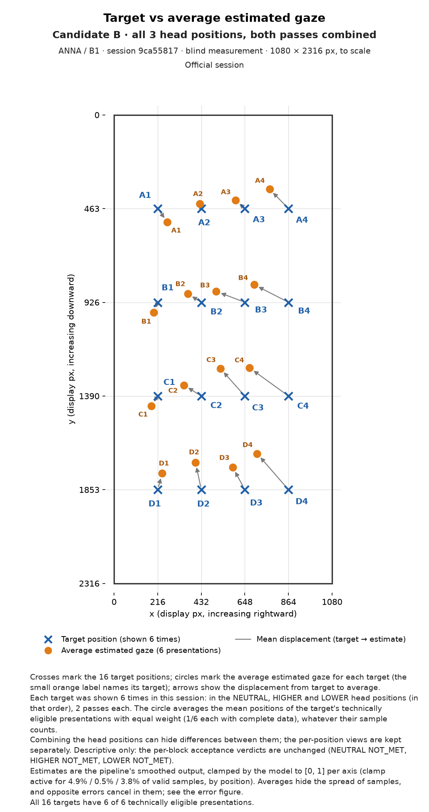
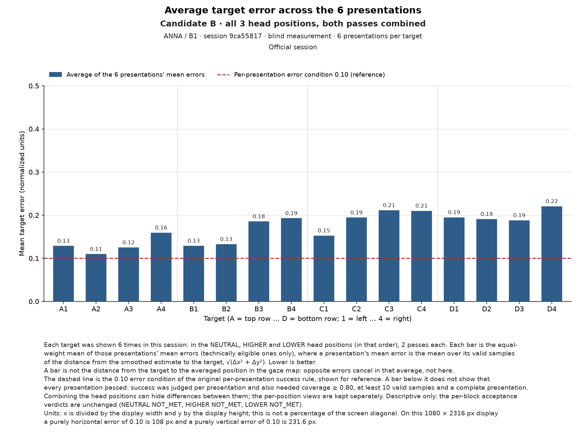

# Calibration comparison — Candidate B: three passes, three head positions

| | |
|---|---|
| Candidate ID | `calibration_b_three_pass_positions` |
| Branch | `experiment/calibration-b-three-poses` |
| `BASE_SHA` | `e8fa01ef1e397f508aa5a3b3a595539b4ef4490a` (`origin/feature/home-screen`) |
| Calibration implementation | `752d1743b7e79f7deb11a86e0dcd345da2a16ceb` |
| Evaluation integration | `8cbfd087b00a4cff50183b4a77f94750a64726eb` (candidate A's evaluation, ported) |
| Measured build | `011fa7cddd03d662c437bc9ed64704292485b8bd` (`git_dirty_at_build` false; APK SHA-256 `9e910a10dbae31cc3fd6a061777fe400a76fb6915a0bc66738d01664a3688cee`): `8cbfd08` plus debug logging and a visible calibration-failure message. Prediction, calibration, evaluation logging and protocol code are byte-identical to `8cbfd08`, and the session replays exactly under both commits |
| Evaluation protocol | `notouch-calibration-comparison-eval` 1.0.0 ([`protocol.json`](protocol.json), SHA-256 of LF bytes `651e4402c8208538ccca1d7e204141315e649c8f15cd3e835f795c689046c547`, the same file as candidate A), log schema 4, snapshot schema 2; plan [`collection-plan-b.json`](collection-plan-b.json); unchanged |
| Data | One complete **official** session, ANNA / B1 (`eval-20261116T012500Z-9ca55817`, 2026-11-16). B2 and the technical pilot were not recorded |
| Result | **NOT_MET in all three head-position blocks.** Tracking criteria (jitter, availability, sample rate, latency) met everywhere; presentation success (4, 11 and 3 of 32) and p95 error (0.307, 0.280, 0.278) failed everywhere |
| Evidence level | Preliminary: one participant, one phone, one session, one calibration. No winner is declared; the comparison with candidate A is a separate step |

## 1. Purpose and scope

The question of this experiment is whether 27 calibration anchors are better collected in one head position
(candidate A) or spread over three (candidate B), with everything else unchanged. **Candidate B** shows the existing
nine calibration targets three times: pass 1 in an ordinary head position, pass 2 slightly higher, pass 3 slightly
lower, with the phone fixed and the head moving only in the 3 s breaks between passes. One `GazeModel.fit` then runs on
all 27 labelled anchors.

The prediction model is the **original, unchanged** one: per screen axis, a linear regression on the two
standardized iris features; face position and scale serve only as a validity check (a frame is rejected if its face
is more than 0.12 from the anchors' mean position in x or y, or its scale outside 0.72–1.28 of the mean). The fit is
rejected if its RMS residual exceeds 0.18. No head-aware prediction is part of these results.

The evaluation measures, for the model of one fresh calibration, target-referenced gaze accuracy, stability,
availability and latency in three instructed head positions, with the protocol's six acceptance criteria per block.

## 2. Method and metrics

**Calibration** (unchanged since `752d174`): nine targets per pass in the original order; per point 1 s settling, at
least 22 samples and 2.5 s, per-feature median; a face shift above 0.045 within a point restarts it; a point over 9 s
fails the calibration; a 2 s blink break after the 4th point of each pass and a 3 s break after passes 1 and 2, the
only moments the head moves. Nothing is fitted before the 27th anchor.

**Evaluation session** (identical to candidate A): one fresh calibration, then three 80 s blocks with the same model.
Each block shows 16 targets at x, y ∈ {0.2, 0.4, 0.6, 0.8}, pass 1 serpentine and pass 2 reversed: 32 presentations of
1.0 s settling + 1.5 s measurement. Before each block a preparation screen names the position, the operator taps
**준비 완료** (Ready) and a 3 s countdown follows; none of this enters a metric. Blind mode: no pointer, gaze clicks,
scrolling and dictation suppressed. The smoothing filter is reset at the session start and every block start.

**Recorded session.** Order NEUTRAL → HIGHER → LOWER (`nhl`, as planned for B1). Declared conditions (entered before
the session): eye–screen distance 30.0 cm, lighting "room with normal light", no glasses, position markers "-" (none
written), no notes. Preparation took 3.4 s, 10.7 s and 2.8 s; the blocks started 99.5 s, 193.2 s and 279.0 s after
the calibration finished.

**Calibration attempts behind this session** (debug log of `011fa7c`: excerpt in
[`data/calibration-attempts/`](data/calibration-attempts/README.md), table in
[`diagnostic_calibration_attempts.csv`](data/derived/diagnostic_calibration_attempts.csv), anchors in
[`diagnostic_calibration_attempt_anchors.csv`](data/derived/diagnostic_calibration_attempt_anchors.csv)). Fit errors of
rejected attempts are recomputed with a replica of the unchanged `GazeModel.fit` that reproduces B1's snapshot bit for
bit. Face height is the logged image-normalized face_y, larger = lower in the image.

| Attempt (2026-11-16 KST) | Result | Fit error | Higher pass vs ordinary | Lower pass vs ordinary |
|---|---|---|---|---|
| 10:05–10:07 | rejected | 0.235 (recomputed) | −0.090 | +0.058 |
| 10:08–10:10 | rejected | 0.257 (recomputed) | −0.025 | +0.099 |
| 10:18–10:20 | accepted; discarded when tracking stopped at 10:21 | 0.144 | −0.014 | +0.045 |
| 10:21–10:23 | **accepted; used by B1** | **0.163** | **−0.008** | **+0.065** |

Two more attempts on 2026-11-15 with build `8cbfd08` most likely ended the same way (inferred from system logs). The
rejected fits failed the unchanged 0.18 limit, mostly vertically; in their higher pass the iris features barely
followed the targets. After the rejections the participant reduced the head movements, so the calibration used here
spans little vertical range: its higher pass is almost at the ordinary position.

**Metrics** (committed analyzer, protocol thresholds, unchanged). The measured coordinate is the pipeline's smoothed
output, clamped to [0, 1] per axis by the model. Errors are normalized per axis (x / display width, y / display
height; on this 1080 × 2316 px display 0.10 is 108 px horizontally or 231.6 px vertically).

| Criterion, per 80 s block | Definition | Target |
|---|---|---|
| Presentation success rate | Successful / 32. Success: complete, ≥ 10 valid samples, valid coverage ≥ 0.80, mean sample error ≤ 0.10 | ≥ 0.80 |
| p95 error | Nearest-rank p95 of presentation mean errors over technically eligible presentations (complete, ≥ 10 valid samples, coverage ≥ 0.5); INSUFFICIENT_DATA below 26 eligible | ≤ 0.20 |
| Jitter | Mean over eligible presentations of the RMS distance of valid samples from their centroid | ≤ 0.05 |
| Availability | Valid / all measurement-phase attempts (invalid and out-of-range included) | ≥ 0.90 |
| Valid samples per second | Valid measurement samples / 48 s | ≥ 10 /s |
| p95 processing latency | Frame acceptance to publication, all settling and measurement attempts | ≤ 200 ms |

A block is MET only if all six criteria are MET; a session is MET only if all three blocks are MET. Percentiles are
never averaged and no pooled metric replaces a criterion.

## 3. Sessions and results

All recordings were exported read-only on 2026-11-16 at 01:34:37 UTC and left on the phone (archive outside the
repository: `C:\Users\user\Desktop\calibartion\phone-exports\candidate-b-collection-20261116T013436Z\export-20261116T013437Z.tar`,
SHA-256 `2b6cbf241212cfe517398d2bd609a73e3281472e9f38ada926198610828bf56f`). The phone holds both candidates' data
(same app ID); `import --calibration-id calibration_b_three_pass_positions` copied only B.

| Session ID | Participant / label | Recorded (UTC) | State | Official | Use |
|---|---|---|---|---|---|
| `eval-20261116T012500Z-9ca55817` | ANNA / B1 | 2026-11-16 01:25:00–01:29:27 | complete: 3/3 blocks, 96/96 presentations, `completed` | **yes** (analyzer: planned label and order, clean build, fresh verified calibration, blind mode) | **Selected** |
| `eval-20261115T093800Z-761b3d19`, `eval-20261115T130702Z-4ee40520` | ANNA (candidate A) | 2026-11-15 | complete | — | Not B data: skipped by the import, never copied |

No B2, no technical pilot, no incomplete or interrupted session. Selection is by session ID, fixed from metadata and
checksums before any metric was computed ([`data/analysis-inputs.json`](data/analysis-inputs.json)).

| Check | Result |
|---|---|
| Checksums and frozen inputs | Device `SHA256SUMS` verified in the export and after the byte-for-byte import; [`data/raw-inputs.sha256`](data/raw-inputs.sha256) (5 files) still matches after analysis and plotting |
| Identity | Candidate `calibration_b_three_pass_positions`, positions by pass `ordinary, higher, lower`; build `011fa7c`, clean; protocol hash, pipeline `home_screen_gaze_pipeline_e8fa01e`, predictor `GazeModel`; snapshot with 27 anchors labelled pass 1–3 × point 1–9 and their positions |
| Accounting | 3,058 attempts accepted = recorded = written, 0 rows lost; preparation 193, countdown 105, settling 1,110, measurement 1,650; 3,055 processed, 3 dropped at block starts by design, 0 processing errors; 4 pipeline resets; analyzer: 0 integrity errors, 0 issues, 0 unassigned rows; 32 of 32 presentations technically eligible in every block |
| Exact replay | All 27 anchors refit to bit-identical parameters; 3,055 processed attempts re-run through `GazePipeline.process` with **0 mismatches** (exact strings), 4 resets. The source of the original APK (`8cbfd08`, separate checkout) gives a byte-identical replay report ([report](data/derived/replay/calibration_b_three_pass_positions/ANNA/eval-20261116T012500Z-9ca55817/replay_report.json)) |

| Session | Pose | Success | p95 error | Jitter | Availability | Valid samples/s | p95 latency | Verdict |
|---|---|---|---|---|---|---|---|---|
| B1 `9ca55817` | NEUTRAL (block 1) | 4/32 (0.125) ✗ | 0.307 ✗ | 0.035 ✓ | 1.000 ✓ | 11.4 ✓ | 57.5 ms ✓ | NOT_MET |
| B1 `9ca55817` | HIGHER (block 2) | 11/32 (0.344) ✗ | 0.280 ✗ | 0.035 ✓ | 1.000 ✓ | 11.4 ✓ | 57.9 ms ✓ | NOT_MET |
| B1 `9ca55817` | LOWER (block 3) | 3/32 (0.094) ✗ | 0.278 ✗ | 0.045 ✓ | 0.998 ✓ | 11.5 ✓ | 58.5 ms ✓ | NOT_MET |
| Target | | ≥ 0.80 | ≤ 0.20 | ≤ 0.05 | ≥ 0.90 | ≥ 10 | ≤ 200 ms | |

**Session verdict: NOT_MET** (official session; not met in NEUTRAL, HIGHER and LOWER).

Supporting values (equal weight per presentation; NEUTRAL / HIGHER / LOWER): mean presentation error 0.196 / 0.136 /
0.178; median 0.179 / 0.129 / 0.186; horizontal bias −0.128 / +0.072 / −0.144 and vertical bias −0.121 / +0.080 /
−0.041 (positive = estimate right of or below the target); model clamp active for 4.9% / 0.5% / 3.8% of valid
samples. Every presentation had at least 16 valid samples and coverage of at least 0.94, so all 78 unsuccessful
presentations failed on the error condition alone.

Complete numerical outputs (generated, never edited by hand) in [`data/derived/`](data/derived/README.md):
[`report.md`](data/derived/report.md) · [`summary.json`](data/derived/summary.json) (everything, unrounded) ·
[`sessions.csv`](data/derived/sessions.csv) · [`blocks.csv`](data/derived/blocks.csv) ·
[`presentations.csv`](data/derived/presentations.csv) · descriptive `diagnostic_*.csv` (region and pass, pass
comparison, clamp edges, axis gain, face position by block, calibration anchors and summary) · plotted values in
[`target_summary.csv`](figures/final/ANNA_B1_9ca55817/target_summary.csv) with
[`figures-manifest.json`](figures/final/ANNA_B1_9ca55817/figures-manifest.json).

## 4. Figures

The two summary figures of candidate A's report, drawn by the same tool ([`figures/`](figures/README.md)). Per target
they combine the session's three blocks and two passes (six presentations, all eligible here), matched by grid
position, each presentation weighted equally:

- **Target vs average estimated gaze.** The screen to scale (x right, y down). Blue crosses: the 16 targets; orange
  circles: mean of the six presentation centroids; arrows: target → average.
- **Average target error.** One bar per target: mean of the six presentation mean sample errors (not the distance
  to the averaged position, in which opposite errors cancel). Dashed line: the 0.10 per-presentation error condition,
  for reference only.

In this session HIGHER's horizontal offset has the opposite sign to NEUTRAL's and LOWER's, so the circles sit closer
to the targets than any single block's estimates; the bars and the per-block table above are the basis for
conclusions. Per-block values are in the derived tables (no per-block figures were drawn).

### Session ANNA / B1 (`eval-20261116T012500Z-9ca55817`, official)

<a href="figures/final/ANNA_B1_9ca55817/cand_b_anna_b1_9ca55817_all_poses_gaze_map.svg"></a>

[](figures/final/ANNA_B1_9ca55817/cand_b_anna_b1_9ca55817_all_poses_target_error.svg)

The error axis is the tool's default 0–0.5 (largest bar 0.22, nothing cropped). Candidate A's final figure needed
0–0.65; a side-by-side comparison should redraw both on one axis.

## 5. Analysis

One official session. Section 5.1 reports measurements; 5.2 lists possible explanations, none established.

### 5.1 Observations

**Tracking was not the problem.** No attempt in the whole session was out of the model's validity range; invalid
measurement attempts were 0, 0 and 1 (a blink). Valid sample rates 11.4–11.5 /s, latency p95 57.5–58.5 ms and jitter
0.035–0.045 met their targets (LOWER's jitter is closest to the 0.05 limit).

**Accuracy failed through systematic offsets.** The distance from target to presentation centroid averages 0.189 /
0.132 / 0.172, almost the whole mean error (0.196 / 0.136 / 0.178), while jitter is about 0.04. Presentations with a
mean error of at most 0.20: 18, 27 and 20 of 32; at most 0.10 (success): 4, 11 and 3.

| Block | Horizontal bias | Vertical bias | Main pattern |
|---|---|---|---|
| NEUTRAL | −0.128 (≈ 138 px left) | −0.121 (≈ 281 px up) | Error grows from left to right (columns 1–4: 0.099, 0.171, 0.222, 0.290); the leftward bias grows with it (−0.052 → −0.228) |
| HIGHER | +0.072 (≈ 78 px right) | +0.080 (≈ 186 px down) | Error grows from right to left (columns 4 → 1: 0.078 → 0.211); best block (11 successes, 8 of them in pass 2) |
| LOWER | −0.144 (≈ 155 px left) | −0.041 (≈ 95 px up) | Error grows to the right (0.142 → 0.217) and downward (rows A–D: 0.115, 0.158, 0.213, 0.226) |

The horizontal estimate is compressed: the slope of the mean estimate on the target is 0.72, 0.75 and 0.81 in x
against 0.97, 0.89 and 0.92 in y. In NEUTRAL and LOWER the right-hand targets were estimated well left of their
position; in HIGHER the whole pattern shifted right and down. Combined over the session, per-target errors range
from 0.109 (A2) to 0.220 (D4), lower in the top row (0.109–0.159) than in rows C–D (0.152–0.220).

**Clamping is minor.** The model clamp acted on 4.9% / 0.5% / 3.8% of valid samples (NEUTRAL: 27 samples above the
top edge, 20% of row A; LOWER: 13 left of the screen). The unclamped linear output's mean error (0.204 / 0.134 /
0.184) is close to the measured one, so the clamp neither hides nor causes the offsets.

**The evaluation positions did not match the calibration positions.** Logged face_y relative to the calibration
reference (mean of the 27 anchors, face_y 0.688, scale 0.158; larger = lower in the image):

| | Ordinary / NEUTRAL | Higher / HIGHER | Lower / LOWER |
|---|---|---|---|
| Calibration passes | −0.019 | −0.027 | +0.046 |
| Evaluation blocks (valid measurement samples) | −0.052 | −0.083 | −0.043 |

All three evaluation blocks had the face higher in the image than the calibration's ordinary pass. HIGHER was 0.032
above NEUTRAL, but LOWER only 0.009 below it and 0.088 above the calibration's lower pass. Face scale stayed within
1.00–1.03 of the reference. The instructed positions were therefore realised differently in calibration and
evaluation, and the evaluation covered a narrow, upward-shifted range.

**Passes.** Pass 2 was worse than pass 1 in NEUTRAL (0.205 vs 0.187; 11 of 16 targets) and LOWER (0.192 vs 0.164; 13
of 16; all 3 LOWER successes are pass 1) and better in HIGHER (0.125 vs 0.146; 7 of 16 worse). Pass 2 comes 40 s
later and in reverse order, so time and order are confounded; the differences are not attributed to drift.

**Calibration diagnostics are not accuracy.** The accepted fit's residual on its own anchors was 0.163 (limit
0.18). It says nothing direct about evaluation accuracy and is not used as evidence for it. The vertical iris
feature separated the calibration rows by 0.027 (row means −0.066, −0.051, −0.039), while the three passes differed
by up to 0.012 at single targets.

**Feasibility.** One usable calibration took four attempts on 2026-11-16; the two with larger head movements were
rejected by the unchanged fit check. This is part of B's result.

### 5.2 Possible explanations (not established)

1. **Little pose diversity in the calibration actually used.** Its higher pass sits 0.008 from the ordinary one, so
   it is closer to a two-position calibration (ordinary, lower). These results do not show how a calibration with
   the intended three distinct positions would perform, because such calibrations were rejected.
2. **Head-position mismatch.** The iris-only model maps iris features to the screen; the rejected calibrations showed
   that raising the head shifts the vertical iris feature by about as much as looking from the top to the bottom row.
   Evaluation blocks held the face higher than all calibration passes, which could contribute to the vertical
   offsets and the block-to-block differences. True eye direction was not measured.
3. **Horizontal compression** (slopes 0.72–0.81) could come from the averaged fit across poses or from a viewing
   geometry different from the calibration's; the data cannot separate these.
4. **HIGHER's better result** comes mostly from the right-hand targets (column 4: 0.078), where its rightward shift
   offset the leftward compression seen in the other blocks. With one session this may be chance rather than a
   property of the higher position.

## 6. Known limitations and future work

- **Size.** One participant, one phone (Samsung SM-S918N, 1080 × 2316 px), one official session (B1) and one
  calibration. B2 (reversed order, `lhn`) was not recorded, so position and time since calibration are confounded.
- **Reference.** Errors are measured against instructed fixation targets, not independently measured eye direction;
  head positions were instructed, only the image-normalized face position is logged.
- **Positions and conditions.** No physical position markers were written down ("-"); the movements were reduced
  after rejected calibrations and differed between calibration and evaluation (5.1). Distance was declared (30 cm),
  not measured; candidate A's sessions declared 20 cm, which matters for the later comparison. Lighting was declared
  only as "room with normal light".
- **Build.** Measured with the diagnostics build `011fa7c`; prediction code identical to `8cbfd08` (exact replay
  under both).
- **Calibration feasibility.** Larger head movements made the unchanged fit reject B's calibration; only small
  movements passed.
- **Future work.** Record B2 under written, physically marked positions and a measured distance shared with
  candidate A. A head-aware prediction model (using head pose instead of only gating on it) is a separate, proposed
  experiment and not part of these results. No winner between A and B is declared.

## 7. Reproduction

### 7.1 Environment

Windows 11, PowerShell, from the repository root. Python 3.14 (standard library) for the data, analyzer and
diagnostics tools and tests; matplotlib 3.11.2 with numpy 2.5.4 for figures only
([`tools/requirements-plot.txt`](tools/requirements-plot.txt)). Kotlin replay: a JDK 17 or 21 set in the current shell
only, Gradle wrapper 8.13, Android SDK path in the ignored `local.properties`, on a checkout of the recording's
`build.git_commit` (`011fa7c`; no APK is built or installed). Phone export: `adb` and the installed debug build.

### 7.2 Inputs and outputs

| What | Path |
|---|---|
| Export archive (outside the repository) | `C:\Users\user\Desktop\calibartion\phone-exports\candidate-b-collection-20261116T013436Z\export-20261116T013437Z.tar` (+ `.sha256`) |
| Raw session (byte-exact) | [`data/raw/`](data/raw/README.md)`calibration_b_three_pass_positions/ANNA/eval-20261116T012500Z-9ca55817/` |
| Frozen raw-input list | [`data/raw-inputs.sha256`](data/raw-inputs.sha256) |
| Selection manifest | [`data/analysis-inputs.json`](data/analysis-inputs.json) |
| Calibration-attempt log excerpt | [`data/calibration-attempts/`](data/calibration-attempts/README.md) |
| Analyzer, replay and diagnostic outputs | [`data/derived/`](data/derived/README.md) |
| Figures | [`figures/final/ANNA_B1_9ca55817/`](figures/final/ANNA_B1_9ca55817/) |

Tools in [`tools/`](tools/): `calib_eval_data.py` (export, verify, import with `--calibration-id`, freeze,
check-frozen), `analyze_calibration_eval.py` (identical to candidate A's), `calib_eval_figures.py` 1.1.1 and
`calib_eval_diagnostics.py` (candidate A's tools at `91994ea`: the diagnostics tool identical, the figure tool apart
from its usage example; tests adapted to B's identity),
`calib_eval_attempts.py` (calibration attempts from the debug log, B only), tests `test_*.py`.
Staging and pilots: [`data/incoming/`](data/incoming/README.md), [`data/pilot/`](data/pilot/README.md) (Git-ignored).

### 7.3 Commands

```powershell
# Export every recording read-only (archive and checksum outside the repository); import candidate B only.
python -B docs\calibration-comparison\tools\calib_eval_data.py export --adb "$env:LOCALAPPDATA\Android\Sdk\platform-tools\adb.exe" --serial R3CW80G6PGW --out <new folder outside the repository>
python -B docs\calibration-comparison\tools\calib_eval_data.py import C:\Users\user\Desktop\calibartion\phone-exports\candidate-b-collection-20261116T013436Z\export-20261116T013437Z --raw docs\calibration-comparison\data\raw --calibration-id calibration_b_three_pass_positions

# Integrity. The frozen list was written once, after the import and before analysis, with
# calib_eval_data.py freeze docs\calibration-comparison\data\raw --out docs\calibration-comparison\data\raw-inputs.sha256 (do not rerun).
python -B docs\calibration-comparison\tools\calib_eval_data.py verify docs\calibration-comparison\data\raw
python -B docs\calibration-comparison\tools\calib_eval_data.py check-frozen docs\calibration-comparison\data\raw docs\calibration-comparison\data\raw-inputs.sha256

# Exact numerical replay with the app's own GazeModel.fit / GazePipeline.process (JVM unit test at the recorded build).
$env:JAVA_HOME = "<path to JDK 17 or 21>"   # this shell only
.\gradlew.bat :app:testDebugUnitTest --tests dev.gazedot.EvaluationReplayRunner -PgazeReplaySession=docs/calibration-comparison/data/raw/calibration_b_three_pass_positions/ANNA/eval-20261116T012500Z-9ca55817 -PgazeReplayOut=docs/calibration-comparison/data/derived/replay

# Metrics (selection by session ID), descriptive diagnostics and the two summary figures.
python -B docs\calibration-comparison\tools\analyze_calibration_eval.py docs\calibration-comparison\data\raw --out docs\calibration-comparison\data\derived --selection docs\calibration-comparison\data\analysis-inputs.json --source-label "ANNA B1 eval-20261116T012500Z-9ca55817, build 011fa7cddd03d662c437bc9ed64704292485b8bd, selection analysis-inputs.json"
python -B docs\calibration-comparison\tools\calib_eval_diagnostics.py --summary docs\calibration-comparison\data\derived\summary.json --selection docs\calibration-comparison\data\analysis-inputs.json --raw docs\calibration-comparison\data\raw --derived docs\calibration-comparison\data\derived
python -B docs\calibration-comparison\tools\calib_eval_figures.py --summary docs\calibration-comparison\data\derived\summary.json --selection docs\calibration-comparison\data\analysis-inputs.json --figures docs\calibration-comparison\figures\final

# Calibration attempts behind the session (debug-log excerpt; refit replica checked against the session snapshot).
python -B docs\calibration-comparison\tools\calib_eval_attempts.py --log docs\calibration-comparison\data\calibration-attempts\notouchdiag-calibration-20261116.log --raw docs\calibration-comparison\data\raw --selection docs\calibration-comparison\data\analysis-inputs.json --derived docs\calibration-comparison\data\derived

# Tool tests (synthetic sessions, plus a check of the repository's selection manifest and frozen list).
python -B -m unittest discover -s docs\calibration-comparison\tools -v
```

On 2026-11-16 these commands produced the outputs above; rerunning the replay, analyzer, diagnostics and figures
reproduces every file byte for byte, and the 85 Python tests pass (analyzer 38, data tool 11, figures 26,
diagnostics 5, calibration attempts 5).

### 7.4 Recording another session (B2)

1. Fix the phone on its stand in portrait orientation; tap **카메라 시작** (Start camera); measure the eye–screen
   distance at the ordinary position.
2. Tap **보정 시작** (Start calibration) and complete the three passes (ordinary → slightly higher → slightly lower,
   moving only in the 3 s breaks). A rejected fit now stays on the home screen as "보정 실패 · …"; calibrate again.
3. After "시선 보정이 완료되었습니다!", press Back, then **설정 · 개발자 기능** → **시선 정확도 평가 · 보정 비교
   (개발용)**. The status must read "이 빌드의 보정 후보: calibration_b_three_pass_positions", "새 보정: 준비됨 ·
   27점 · …" and "평가를 시작할 수 있습니다."
4. Choose **ANNA · B2 · 아래 → 위 → 기본 (공식)** (or **PILOT01 · TB1 · 기술 시험 (공식 아님)** for a technical pilot),
   overwrite the pre-filled distance, lighting and **자세 기준 메모** with the actual values, keep **블라인드 측정
   (기본)**, and tap **평가 시작**.
5. For each block take the position shown, tap **준비 완료**, then follow 32 dots (80 s). Back, leaving the screen,
   screen-off or stopping tracking end the session as incomplete and use up the calibration.
6. Export and import as in 7.3; add the session to a new selection manifest and frozen list for the new scope (never
   edit the existing ones) and record any excluded or incomplete session with its reason.
