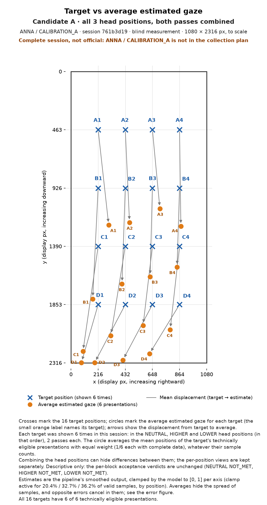
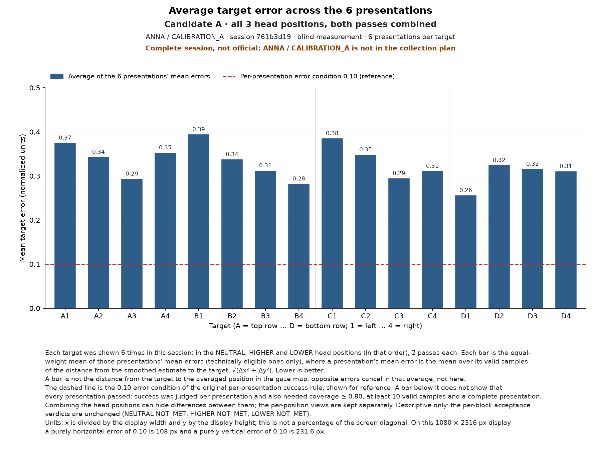

# Calibration comparison — Candidate A: three passes, one head position

> **Archived exploratory write-up.** This is the candidate A report as it stood on 2026-11-15 for the first,
> exploratory collection, ANNA / `CALIBRATION_A` (`eval-20261115T093800Z-761b3d19`, complete, not official), before the
> final collection replaced it in the main report ([`../../README.md`](../../README.md)). Text, numbers and conclusions
> are unchanged; only relative links were adjusted to this location. They describe that one session and are not carried
> forward to the final collection.
>
> Inputs and outputs of this write-up are preserved unchanged: [`data/analysis-inputs.json`](../../data/analysis-inputs.json),
> [`data/raw-inputs.sha256`](../../data/raw-inputs.sha256), [`data/derived/`](../../data/derived/README.md),
> [`figures/draft/ANNA_CALIBRATION_A_761b3d19/`](../../figures/draft/ANNA_CALIBRATION_A_761b3d19/) and the per-position
> figures in [`figures/archive/`](../../figures/archive/ANNA_CALIBRATION_A_761b3d19_by_pose/README.md).
>
> Reproducing it since the final collection was imported: `data/raw/` also holds `eval-20261115T130702Z-4ee40520`, so
> `check-frozen … raw-inputs.sha256` lists that session's 5 files as added later (no file missing or changed), and a
> fresh analyzer run with `analysis-inputs.json` writes identical tables, with `summary.json` differing only in
> `"excluded_by_selection": 1` (was 0). Point the replay command at the session folder
> (`-PgazeReplaySession=docs/calibration-comparison/data/raw/calibration_a_three_pass_static/ANNA/eval-20261115T093800Z-761b3d19`)
> so that it does not write a report for the new session into `data/derived/replay/`. The draft figures and table
> regenerate byte-identically from the preserved `data/derived/summary.json` with `calib_eval_figures.py` 1.1.1 (only
> the tool version in the manifest differs). To check reproduction, send every `--out`, `--derived`, `--figures` and
> `-PgazeReplayOut` below to a scratch folder and compare: `data/derived/` and `figures/draft/` are kept as generated.

| | |
|---|---|
| Candidate ID | `calibration_a_three_pass_static` |
| Branch | `experiment/calibration-a-three-pass` |
| `BASE_SHA` | `e8fa01ef1e397f508aa5a3b3a595539b4ef4490a` (`origin/feature/home-screen`, fetched 2026-11-14) |
| Calibration implementation | `94f1f8c90f09d10763d4a054481888b10f42cd1e` |
| Evaluation integration | `188898b5444015f9d4f07b44dba9c2e323760d7b` |
| Measured build | `f3b224c4801570c57a192d354eb848b30c90b3c3` (evaluation integration plus a home-screen layout fix; `git_dirty_at_build` false; APK SHA-256 `d19ac6cf507a8f1ed67cda0d074879080310d73af99c2581b4fed586b6d58bbc`) |
| Evaluation protocol | `notouch-calibration-comparison-eval` 1.0.0 ([`protocol.json`](../../protocol.json), SHA-256 of LF bytes `651e4402c8208538ccca1d7e204141315e649c8f15cd3e835f795c689046c547`), log schema 4, snapshot schema 2 |
| Data | One complete session, ANNA / `CALIBRATION_A` (2026-11-15), **not official**: its recorded label is outside the protocol's collection plan. No official session and no pilot were recorded. This is the first, exploratory collection; another collection, under different lighting, is planned. |
| Result | **NOT_MET in all three head-position blocks.** Presentation success and p95 error fail in every block; jitter, availability, valid sample rate and latency pass in every block. |
| Evidence level | Preliminary: one participant, one phone, one session, one calibration. Not a completed formal accuracy evaluation. Candidate B has not been measured. |

## 1. Purpose and scope

The Iteration 3 evaluation of the nine-point home-screen calibration did not meet its accuracy targets, mostly because
of a systematic offset. This experiment asks one question about calibration data:

> With the same amount of calibration data, 27 anchors (three passes through the existing nine targets), is it
> better to repeat the calibration in one head position (candidate A) or to spread it over several head positions
> (candidate B)?

**What candidate A changes.** Calibration shows the existing nine targets three times while the participant keeps the
same head position, and fits the model once on all 27 anchors (instead of one pass of nine).

**What stays unchanged.** Feature extraction (`LandmarkFeatures`), eye-state detection, the model (`GazeModel`: for each
screen axis, a linear regression on the two standardized iris features), the per-point collection rules, the validity
gates, smoothing (`GazePipeline`, factor 0.28), coordinates and the interaction rules. Tests require fit, prediction,
feature extraction and the per-point median to equal frozen copies from `BASE_SHA` bit for bit.

**What this evaluation can establish.** How the single model fitted by candidate A performs for one participant on
one phone across three instructed head positions, judged against the predeclared Iteration 3 engineering targets. It
is the A half of the A/B comparison. It cannot establish whether A is better than B, how A generalizes to other
people, phones or sessions, the participant's true eye direction (targets are instructed fixation points) or the
measured head pose (positions are instructed; face position is only logged).

## 2. Implementation and evaluation method

### 2.1 Calibration (candidate A, unchanged since `94f1f8c`)

The nine existing targets (x, y ∈ {0.15, 0.5, 0.85}) in the existing order, three times: 27 anchors. Per point, unchanged
from `BASE_SHA`: 1,000 ms settling; at least 22 accepted samples and 2,500 ms; the per-feature median; samples 0–250 ms
old with quality TRACKING or OUT_OF_RANGE; a face shift greater than 0.045 from the point median restarts the point;
more than 9,000 ms fails the calibration. Breaks: 2 s after the 4th point of every pass and 3 s after passes 1 and 2.
One `GazeModel.fit` on all 27 anchors in collection order. On screen: "시선 보정 · 2/3회차 · 4/9" (pass 2/3, point 4/9)
and "자세: 처음 자세 그대로 · 정면, 같은 거리" (keep the starting position, front-facing, same distance).

### 2.2 Evaluation session

One fresh, successful calibration, then one session of three head-position blocks with the **same model** throughout
(no recalibration, model change or tracking stop between blocks).

| | |
|---|---|
| Blocks | NEUTRAL (기본 위치), HIGHER (조금 높은 위치, slightly higher), LOWER (조금 낮은 위치, slightly lower) |
| Each block | The Iteration 3 schedule: 16 targets at x, y ∈ {0.2, 0.4, 0.6, 0.8}; pass 1 in serpentine order, pass 2 in reverse; 32 presentations of 1.0 s settling + 1.5 s measurement (80 s) |
| Before each block | A preparation screen naming the position, an explicit **준비 완료** (Ready) tap by the operator, then a 3 s countdown. Neither counts toward any metric, including latency |
| Smoothing reset | A logged pipeline reset at the session start and at every block start |
| Blind mode | No pointer; gaze clicks, scrolling and dictation suppressed for the whole session |
| Planned orders | ANNA / A1: NEUTRAL → HIGHER → LOWER (`nhl`); ANNA / A2: LOWER → HIGHER → NEUTRAL (`lhn`); technical pilot PILOT01 / T1 (`nhl`) |
| Recorded | ANNA / `CALIBRATION_A`, order `nhl` (see 3.1) |
| Conditions (declared by the operator) | Eye–screen distance 20.0 cm; lighting "room with normal light"; no glasses; head-position markers "-" (none written) |

### 2.3 Metrics and predeclared thresholds

All values come from the committed analyzer (`tools/analyze_calibration_eval.py`) and protocol, unchanged after the data
were seen. The measured coordinate is the pipeline's **smoothed output, clamped to [0, 1] per axis by the model**.
Spatial values are in normalized units: x divided by the display width and y by the display height (on this
1080 × 2316 px display, 0.10 is 108 px horizontally or 231.6 px vertically). They are not percentages of the diagonal.

| Criterion, per 80 s block | Definition | Target |
|---|---|---|
| Presentation success rate | Successful presentations / 32. Success = complete presentation, ≥ 10 valid samples, valid coverage ≥ 0.80 and mean sample error ≤ 0.10 | ≥ 0.80 |
| p95 error | Nearest-rank p95 of presentation mean errors over technically eligible presentations (complete, ≥ 10 valid samples, coverage ≥ 0.5); INSUFFICIENT_DATA if fewer than 26 are eligible | ≤ 0.20 |
| Jitter | Mean over eligible presentations of the RMS distance of valid samples from their centroid | ≤ 0.05 |
| Availability | Valid / all measurement-phase attempts (invalid and discarded included) | ≥ 0.90 |
| Valid samples per second | Valid measurement samples / 48 s | ≥ 10 /s |
| p95 processing latency | Nearest-rank p95 from frame acceptance to publication, over all settling and measurement attempts of the block | ≤ 200 ms |

A block is MET only if all six criteria are MET; a session is MET only if all three blocks are MET. Blocks are reported
separately and percentiles are never averaged. The calibration fit error is a diagnostic only.

## 3. Collected sessions and results

### 3.1 Recordings

One recording was on the phone and was exported on 2026-11-15 (archive outside the repository:
`C:\Users\user\Desktop\calibartion\phone-exports\export-20261115T094943Z.tar`, SHA-256
`72ee0a3ae98858eb04dd3d2b3948b993a5548241aca8c621ebe33bf8cd52e18d`; the recording was left on the phone).

| Field | Value |
|---|---|
| Participant / recorded label | ANNA / `CALIBRATION_A` (kept as recorded) |
| Session ID | `eval-20261115T093800Z-761b3d19` (short ID `761b3d19`) |
| Start / end (UTC) | 2026-11-15 09:38:00.179 / 09:43:22.914 (322.7 s) |
| Designation | **Complete, not official.** The protocol's official candidate A sessions are ANNA / A1 (`nhl`) and ANNA / A2 (`lhn`); a session outside the collection plan is never official. Its block order matches the planned A1 order. It is not a pilot |
| State | `complete`, end reason `completed`; 3/3 blocks, 96/96 presentations; blind measurement |
| Build | `f3b224c4801570c57a192d354eb848b30c90b3c3`, dirty flag `false`, descends from `BASE_SHA` |
| Calibration | `calibration_a_three_pass_static`, serial 1, 27 anchors (3 passes × 9), 0 movement retries, 89.0 s, inputs SHA-256 `ad5c9fe9…6fbf28c6`, refit verified, no earlier session on it, 122.0 s old at session start |
| Protocol / schemas | `notouch-calibration-comparison-eval` 1.0.0 (manifest hash matches), log schema 4, snapshot schema 2, pipeline `home_screen_gaze_pipeline_e8fa01e` |
| Device / display | Samsung SM-S918N, Android 16; 1080 × 2316 px, rotation 0 (calibration, evaluation and overlay views all full screen) |
| Block timeline | NEUTRAL starts 138.8 s, HIGHER 242.2 s, LOWER 364.6 s after calibration; preparation 13.8 s, 20.4 s, 39.4 s |

**Pilots and incomplete recordings:** none were recorded. **Official sessions:** none. The analysis therefore uses the
one complete candidate A session, selected by its session ID under a rule fixed before any metric was computed
([`data/analysis-inputs.json`](../../data/analysis-inputs.json)), and every result here is labelled non-official.

### 3.2 Data checks

| Check | Result |
|---|---|
| Checksums | The five files are byte-identical on the phone, in the export and in `data/raw/`; `SHA256SUMS` written on the phone verifies; the frozen-input list [`data/raw-inputs.sha256`](../../data/raw-inputs.sha256) (new; no earlier list existed) still matches after analysis and plotting |
| Identity | Candidate, protocol hash, pipeline variant, schema versions and display geometry are as declared; the model snapshot holds 27 anchors labelled pass 1–3 × point 1–9 in collection order |
| Accounting | 3,738 attempts accepted = recorded = written, 0 rows lost; preparation 853, countdown 105, settling 1,120, measurement 1,660; 3,736 processed, 2 `discarded_block_start` (results in flight at a block start, dropped before smoothing as designed), 0 processing errors; 4 pipeline resets (1 session start, 3 block starts); 2 results in flight before the session start dropped as designed |
| Analyzer integrity | 0 integrity errors, 0 issues, 0 unassigned rows; every block has 32 complete presentations, all 32 technically eligible |
| Exact replay | The Kotlin replay at the recorded build refit all 27 anchors in recorded order to bit-identical parameters and re-ran the app's own `GazePipeline.process`: 3,736 processed attempts, **0 mismatches** (compared as exact strings), 4 resets applied ([replay report](../../data/derived/replay/calibration_a_three_pass_static/ANNA/eval-20261115T093800Z-761b3d19/replay_report.json)) |

One minor observation: the session's final attempt (accepted inside the last LOWER presentation, pass 2 A1) was
handled 28 ms after the session had ended, when blind mode had already been released, so the overlay drew the pointer
once. This happened after the last target had gone and cannot have guided fixation; by the protocol's rule the sample
belongs to the window in which it was accepted.

### 3.3 Results

| Session | Pose | Success | p95 error | Jitter | Availability | Valid samples/s | p95 latency | Verdict |
|---|---|---|---|---|---|---|---|---|
| `761b3d19` (not official) | NEUTRAL (block 1) | 0/32 (0.000) ✗ | 0.423 ✗ | 0.030 ✓ | 0.996 ✓ | 11.6 ✓ | 57.9 ms ✓ | NOT_MET |
| `761b3d19` (not official) | HIGHER (block 2) | 1/32 (0.031) ✗ | 0.446 ✗ | 0.028 ✓ | 0.996 ✓ | 11.4 ✓ | 58.0 ms ✓ | NOT_MET |
| `761b3d19` (not official) | LOWER (block 3) | 0/32 (0.000) ✗ | 0.633 ✗ | 0.028 ✓ | 1.000 ✓ | 11.5 ✓ | 57.6 ms ✓ | NOT_MET |
| Target | | ≥ 0.80 | ≤ 0.20 | ≤ 0.05 | ≥ 0.90 | ≥ 10 | ≤ 200 ms | |

**Session verdict: NOT_MET** (not met in NEUTRAL, HIGHER and LOWER). The session is not official.

Supporting values (descriptive, equal weight per presentation): mean presentation error 0.279 / 0.293 / 0.408; mean
horizontal bias +0.063 / −0.113 / −0.151; mean vertical bias +0.255 / +0.247 / +0.345 (positive = estimate right of or
below the target); model clamp active for 20.4% / 32.7% / 36.2% of valid measurement samples (NEUTRAL / HIGHER / LOWER).
Every presentation had at least 15 valid samples and at least 0.88 coverage, so all 95 unsuccessful presentations
failed on the error condition alone.

Complete numerical outputs (generated; never edited by hand):
[`report.md`](../../data/derived/report.md) ·
[`summary.json`](../../data/derived/summary.json) (everything, unrounded) ·
[`sessions.csv`](../../data/derived/sessions.csv) ·
[`blocks.csv`](../../data/derived/blocks.csv) ·
[`presentations.csv`](../../data/derived/presentations.csv) ·
descriptive diagnostics `data/derived/diagnostic_*.csv` (region and pass, pass comparison, clamp edges, axis gain,
face position by block, calibration anchors and summary) ·
plotted values of the summary figures in
[`target_summary.csv`](../../figures/draft/ANNA_CALIBRATION_A_761b3d19/target_summary.csv) with
[`figures-manifest.json`](../../figures/draft/ANNA_CALIBRATION_A_761b3d19/figures-manifest.json); the per-position plot
tables are archived with their figures.

## 4. Figures

**Draft view of the first exploratory recording.** Two figures for the session, each combining, per target, all three
head positions and both passes (six presentations per target). They are descriptive only: no pooled acceptance result
is computed, and the per-block results and verdicts in section 3.3 are unchanged. Combining positions can hide
differences between them; the original per-position figures (two per block) are archived in
[`figures/archive/ANNA_CALIBRATION_A_761b3d19_by_pose/`](../../figures/archive/ANNA_CALIBRATION_A_761b3d19_by_pose/README.md).
More detail on reading the figures: [`figures/README.md`](../../figures/README.md).

- **Target vs average estimated gaze.** The screen to scale (x to the right, y downward). Blue crosses are the 16
  target positions; orange circles are the average estimated gaze per target: the equal-weight mean of the six
  presentations' mean positions (one sixth each, whatever their sample counts); arrows go from target to average. The
  small orange label names the target. Averages hide the spread of the samples, and opposite errors cancel in them.
- **Average target error across the six presentations.** One bar per target: the equal-weight mean of the six
  presentations' mean sample errors (lower is better). It is not the distance from the target to the averaged
  position, in which opposite errors would cancel. The dashed 0.10 line is the error condition of the original
  per-presentation success rule, for reference only: a bar below it would not mean every presentation passed.
  Fewer than six contributing presentations would be marked partial with their count (for example 4/6), none as N/A;
  here all 96 presentations are technically eligible.

### Session ANNA / CALIBRATION_A (`eval-20261115T093800Z-761b3d19`, not official)

<a href="../../figures/draft/ANNA_CALIBRATION_A_761b3d19/cand_a_anna_calibration_a_761b3d19_all_poses_gaze_map.svg"></a>

[](../../figures/draft/ANNA_CALIBRATION_A_761b3d19/cand_a_anna_calibration_a_761b3d19_all_poses_target_error.svg)

## 5. Analysis and interpretation

All statements below describe one non-official session. Section 5.1 reports what was measured; section 5.3 lists
possible explanations, none of which is established.

### 5.1 Measured findings

**Criteria.** Tracking quality and speed met their targets in every block: availability 0.996–1.000, 11.4–11.6 valid
samples per second, jitter 0.028–0.030 and p95 latency 57.6–58.0 ms. Accuracy did not: 1 of 96 presentations succeeded
(HIGHER pass 2, target A3, mean error 0.082), and p95 error was 0.423, 0.446 and 0.633, two to three times the 0.20 target.
Only 8 of 96 presentations had a mean error of 0.20 or less (3 in NEUTRAL, 4 in HIGHER, 1 in LOWER).

**The error is a systematic offset, not noise.** The distance from the target to each presentation's centroid averages
0.278 / 0.292 / 0.408, almost the whole mean sample error (0.279 / 0.293 / 0.408), while jitter is about 0.03.
Estimates were consistently placed in the wrong spot rather than scattered around the target.

**Direction of the offset.** In every block the estimates lie **below** the targets: mean vertical bias +0.255
(≈ 591 px), +0.247 (≈ 571 px) and +0.345 (≈ 800 px). The horizontal bias changes sign with position: +0.063 (≈ 68 px,
right) in NEUTRAL, −0.113 (≈ 122 px, left) in HIGHER and −0.151 (≈ 163 px, left) in LOWER.

**Screen regions.** In NEUTRAL the mean error by row was A 0.291, B 0.356, C 0.283, D 0.186, and by column 0.258–0.309.
The bottom row looks best partly because of the clamp: its targets sit at y = 0.8, so a downward offset can show at most
0.20, and its vertical bias is 0.173 / 0.200 / 0.196 with 64% / 100% / 92% of its samples clamped. In HIGHER the rows
were 0.239 / 0.260 / 0.344 / 0.328 (top to bottom); in LOWER 0.491 / 0.377 / 0.376 / 0.389, the top row worst.
Column differences were smaller than row differences in every block.

**Compression.** In NEUTRAL and HIGHER the mean estimate follows the target with roughly unit gain (least-squares
slope of centroid on target: x 1.00 and 1.01, y 0.88 and 1.00): the pattern is shifted, not compressed. In LOWER the
vertical slope of the measured coordinate drops to 0.55 and every per-target mean estimate lies at y > 0.62, i.e. in
the lower 38% of the screen. The model's unclamped output has a vertical slope of 1.20 there (1.39 in HIGHER), so this
compression comes from the bottom clamp acting on a downward-shifted pattern, not from the model flattening its output.

**Clamping.** The clamp acted almost only at the bottom edge (109 of 113, 178 of 179 and 200 of 200 clamped samples),
plus the left edge in HIGHER (55) and LOWER (62); never at the top. It makes the measured errors smaller, not larger:
the analyzer's mean error of the unclamped linear output is 0.291 / 0.345 / 0.512 against 0.279 / 0.293 / 0.408 for
the measured coordinate. Clamping therefore cannot explain the failures; it does hide part of the vertical offset,
especially in the bottom rows, and it distorts the apparent shape of the estimate pattern near the bottom edge.

**Passes.** Within each block, pass 2 starts 40 s after pass 1 and shows the targets in reverse order. Its mean error was lower
than pass 1 for 14 of 16 targets in NEUTRAL (block means 0.311 → 0.247) and 15 of 16 in LOWER (0.482 → 0.334), but
higher in HIGHER (0.278 → 0.307, lower for only 5 of 16). Time, target order and preceding target all differ between
passes, so the difference cannot be attributed to drift or adaptation alone.

**Availability across positions.** Availability and valid sample rate did not deteriorate in HIGHER or LOWER. The only
invalid measurement attempts were blinks (`closed`: 2, 2 and 0). All 429 out-of-range attempts happened during
preparation (39, 44 and 346 in blocks 1–3), mostly while the participant moved into the LOWER position during its
39.4 s preparation; preparation never counts.

**Observed head positions** (logged face position during valid measurement samples, image-normalized, relative to the
mean of the 27 calibration anchors: face_x 0.532, face_y 0.824, scale 0.265). NEUTRAL: face_y −0.012, face_x +0.051,
scale ×1.01. HIGHER: face_y −0.044, face_x +0.026, scale ×0.95. LOWER: face_y +0.089, face_x +0.010, scale ×1.06.
Relative to NEUTRAL, HIGHER moved the face up by 0.032 and LOWER down by 0.100: the two instructed displacements were
clearly asymmetric. All stayed within the model's validity limits (±0.12 shift, scale 0.72–1.28), so no measurement
frame was rejected for pose. The block with the largest displacement (LOWER) had the largest error, but it was also
the last block (364.6 s after calibration), so position and time are confounded.

### 5.2 Calibration context (descriptive)

From the model snapshot ([`diagnostic_calibration_summary.csv`](../../data/derived/diagnostic_calibration_summary.csv)):

- Although candidate A instructs one fixed head position, the logged face_y moved down across the three calibration
  passes: 0.787, 0.834, 0.850 (face_x 0.530–0.534, scale 0.264–0.268). No point was restarted (0 movement retries); the
  restart rule only catches movement within a point.
- The vertical iris feature separated the calibration rows by only 0.018 (row means −0.076, −0.065, −0.058 from top to
  bottom). At single targets the three passes differed by up to 0.016 (top right) and 0.010 (top centre), the same
  order as that whole separation; at the other seven targets by 0.001–0.006.
- The fitted model moves its vertical output by about 31 screen heights per unit of the vertical feature, so a 0.016
  feature difference corresponds to about 0.49 of the screen height. Its horizontal output depends almost equally on
  both features (−16.0 per unit of f_x, −15.8 per unit of f_y).
- The fit's RMS residual on its own 27 anchors is 0.141 (a calibration diagnostic, not gaze accuracy).

### 5.3 Possible explanations (not established)

1. **Noisy vertical calibration data.** The head drift during calibration, the small vertical feature separation and the
   large between-pass differences at the top targets are consistent with an uncertain vertical mapping. That would
   produce a vertical offset even in NEUTRAL, where the logged face position was close to the calibration mean.
   This session cannot show that this caused the offset: true gaze was not measured and there is only one calibration.
2. **Cross-coupling of the features.** Because the horizontal output depends on the vertical feature, a vertical
   feature change (for example from a head-height change) also moves the horizontal estimate. This may contribute to the
   horizontal bias changing between positions, but the data here do not separate it from other causes.
3. **Viewing distance.** The declared 20 cm is closer than the 30–50 cm the home screen recommends. Its effect on the
   features was not tested.
4. **Position versus time.** LOWER's larger error coincides with the largest face displacement and with the longest
   time since calibration; with one fixed block order these cannot be separated.

The failures are not explained by tracking loss, latency, jitter or a visible pointer: all four were controlled or met.

**Historical context only.** The Iteration 3 sessions (an older application base, build `a8f08696`, nine-point
calibration, one 80 s block without instructed head positions) also failed accuracy with success rates of 0.063 and
0.031 and p95 errors of 0.381 and 0.385. They are not a matched control and support no claim of improvement or
deterioration.

## 6. Known limitations and next steps

- **Sample size.** One participant, one phone (SM-S918N), one session and one calibration. Results may not hold for
  other sessions of the same person, let alone other people.
- **Not official.** The only session carries the label `CALIBRATION_A`, outside the collection plan, and the reversed
  order (A2, `lhn`) was not recorded.
- **Reference.** Errors are measured against instructed fixation targets, not independently measured eye direction.
- **Head positions.** HIGHER and LOWER were instructed, not measured; no physical markers were written down ("-"), and
  the logged face position shows an asymmetric displacement (up 0.032, down 0.100 relative to NEUTRAL).
- **Order and time.** One fixed order (`nhl`): position is confounded with time since calibration (138.8 s, 242.2 s and
  364.6 s at block start) and with the longer preparations before later blocks; pass 2 is later than pass 1 and
  reverses the target order.
- **Conditions.** Declared distance 20 cm, outside the recommended 30–50 cm.
- **Clamped coordinate.** By protocol the measured coordinate is clamped to the screen, which caps errors near the
  edges (here mainly the bottom row).
- **Candidate B.** Not yet measured; no comparison between A and B is made or implied.

Focused next steps supported by these findings:

1. Record the planned official sessions **A1 (`nhl`) and A2 (`lhn`)** with the presets' labels, a measured distance
   within 30–50 cm and written head-position markers; the reversed order of A2 separates position from time.
2. Keep the head supported (for example a chin rest) during calibration, and check after each session whether the
   calibration face position drifts across passes and whether the passes agree at the top targets
   (`diagnostic_calibration_summary.csv`).
3. Port the evaluation to candidate B and record B1 and B2 under the same conditions before any comparison.

## 7. Reproduction

### 7.1 Environment

- Windows 11, PowerShell, from the repository root. Python 3.14 with the standard library for the analyzer, data,
  diagnostics and test tools; matplotlib 3.11.2 with numpy 2.5.4 for figures only
  ([`tools/requirements-plot.txt`](../../tools/requirements-plot.txt); the figure checksums were produced with exactly
  these versions).
- Kotlin replay: a JDK 17 or 21 set in the current shell only (`$env:JAVA_HOME`), Gradle wrapper 8.13, Android SDK
  path in the ignored `local.properties`. The replay must run on a checkout of the recording's `build.git_commit`
  (here `f3b224c…`, the current branch head when this analysis was made).
- Phone export: Android platform tools (`adb`) and a debug build of the app (`run-as`).

### 7.2 Inputs, outputs and selection

| What | Where |
|---|---|
| Protocol | [`protocol.json`](../../protocol.json) |
| Raw sessions (byte-exact, never edited) | [`data/raw/`](../../data/raw/README.md)`<calibration_id>/<participant>/<session_id>/` |
| Frozen raw-input checksums | [`data/raw-inputs.sha256`](../../data/raw-inputs.sha256) |
| Selection manifest | [`data/analysis-inputs.json`](../../data/analysis-inputs.json): sessions are listed by unique `session_id` under `included`; the analyzer analyzes only those and records the manifest's hash; the figure tool refuses a summary produced from another selection or an edited manifest |
| Analyzer, replay and diagnostic outputs | [`data/derived/`](../../data/derived/README.md) |
| Figures | [`figures/`](../../figures/README.md): `draft/<PARTICIPANT>_<LABEL>_<id8>/` per session (figures, `target_summary.csv`, manifest); archived per-position views in `archive/` |
| Tools | [`tools/`](../../tools/): `calib_eval_data.py` (export, verify, import, freeze, check-frozen), `analyze_calibration_eval.py`, `calib_eval_figures.py`, `calib_eval_diagnostics.py`, tests `test_*.py` |
| Technical pilots / staging | [`data/pilot/`](../../data/pilot/README.md), [`data/incoming/`](../../data/incoming/README.md) (Git-ignored) |

Selection rule (fixed before analysis): include every candidate session that is complete (3/3 blocks), finalized with
verified checksums and recorded in blind mode from a clean build, whatever its accuracy. Official status is never
changed by selection; the analyzer applies the protocol's rule and every output states it. Pilots are analyzed
separately from `data/pilot/` with outputs outside `data/derived/`, and never appear in these results.

### 7.3 Commands

```powershell
# Integrity: checksums written on the phone, and the frozen raw-input list.
python -B docs\calibration-comparison\tools\calib_eval_data.py verify docs\calibration-comparison\data\raw
python -B docs\calibration-comparison\tools\calib_eval_data.py check-frozen docs\calibration-comparison\data\raw docs\calibration-comparison\data\raw-inputs.sha256

# Exact numerical replay with the app's own GazeModel.fit / GazePipeline.process (checkout of the recorded build).
$env:JAVA_HOME = "<path to JDK 17 or 21>"   # this shell only
.\gradlew.bat :app:testDebugUnitTest --tests dev.gazedot.EvaluationReplayRunner -PgazeReplaySession=docs/calibration-comparison/data/raw -PgazeReplayOut=docs/calibration-comparison/data/derived/replay

# Metrics (selection by session ID), then figures and descriptive diagnostics from the analyzer's summary.json.
python -B docs\calibration-comparison\tools\analyze_calibration_eval.py docs\calibration-comparison\data\raw --out docs\calibration-comparison\data\derived --selection docs\calibration-comparison\data\analysis-inputs.json --source-label "ANNA CALIBRATION_A eval-20261115T093800Z-761b3d19 (complete, not official), build f3b224c4801570c57a192d354eb848b30c90b3c3, selection analysis-inputs.json"
python -B docs\calibration-comparison\tools\calib_eval_figures.py --summary docs\calibration-comparison\data\derived\summary.json --selection docs\calibration-comparison\data\analysis-inputs.json --figures docs\calibration-comparison\figures\draft
#   (writes one folder per selected session; refuses to overwrite a folder with different figures unless --replace is given;
#    the archived per-position views come from --view per-block --derived <dir>, see figures/archive/.../README.md)
python -B docs\calibration-comparison\tools\calib_eval_diagnostics.py --summary docs\calibration-comparison\data\derived\summary.json --selection docs\calibration-comparison\data\analysis-inputs.json --raw docs\calibration-comparison\data\raw --derived docs\calibration-comparison\data\derived

# Tool tests (synthetic data only, plus checks that read the repository's selection manifest).
python -B -m unittest discover -s docs\calibration-comparison\tools -v
```

Rerunning with the same inputs and library versions reproduces the same bytes. On 2026-11-15 the 71 Python tests
passed (analyzer 34, data tool 8, figures 24, diagnostics 5), and the replay, analysis, figures and diagnostics above
were produced with these commands.

### 7.4 Collecting another compatible session

1. Install the debug build of this branch, fix the phone on its stand in portrait orientation, tap **카메라 시작**
   (Start camera) and complete the permission steps (accessibility service **NoTouch 눈 조작**, display over other apps,
   camera). Measure the eye–screen distance at the neutral position (30–50 cm).
2. Tap **보정 시작** (Start calibration) and complete all three passes until "보정 완료" (calibration complete) appears.
   Keep the head still; do not choose recalibration in the tutorial.
3. Press Back, tap **설정 · 개발자 기능**, then **시선 정확도 평가 · 보정 비교 (개발용)**. The status must read
   "새 보정: 준비됨 · 27점" and "평가를 시작할 수 있습니다."
4. Choose a preset (**ANNA · A1 · 기본 → 위 → 아래** or **ANNA · A2 · 아래 → 위 → 기본**; **PILOT01 · T1** for a technical
   pilot), fill in 눈–화면 거리, 조명, 안경 and **자세 기준 메모** (the physical markers for the three positions), keep
   **블라인드 측정 (기본)** and tap **평가 시작**.
5. For each block: the participant takes the position shown, the operator taps **준비 완료** gently, a 3 s countdown
   follows, then 32 dots (80 s). Back, leaving the screen, screen-off or stopping tracking ends the session as
   incomplete and uses up the calibration.
6. Export (read-only, keeps the archive and its checksum), keep the archive outside the repository, then import:

```powershell
python -B docs\calibration-comparison\tools\calib_eval_data.py export --adb "$env:LOCALAPPDATA\Android\Sdk\platform-tools\adb.exe" --serial <serial> --out <folder outside the repository>
python -B docs\calibration-comparison\tools\calib_eval_data.py import <export>\files\evaluation\calibration-comparison\ANNA --raw docs\calibration-comparison\data\raw
python -B docs\calibration-comparison\tools\calib_eval_data.py import <export>\files\evaluation\calibration-comparison\PILOT01 --raw docs\calibration-comparison\data\pilot --allow-pilot
```

Then add the new session ID to `data/analysis-inputs.json` (or record why it is excluded), check the existing frozen
list, write a new one and note the addition, and rerun 7.3. The import never overwrites raw data and refuses sessions
whose checksums fail.
