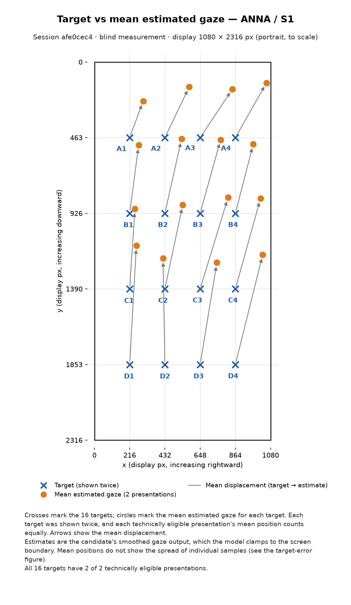
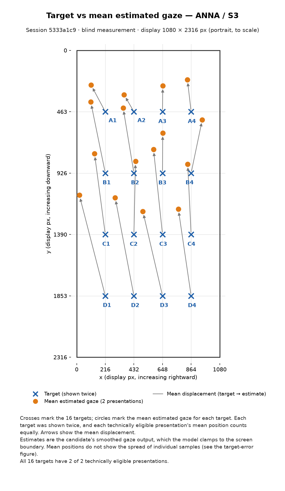
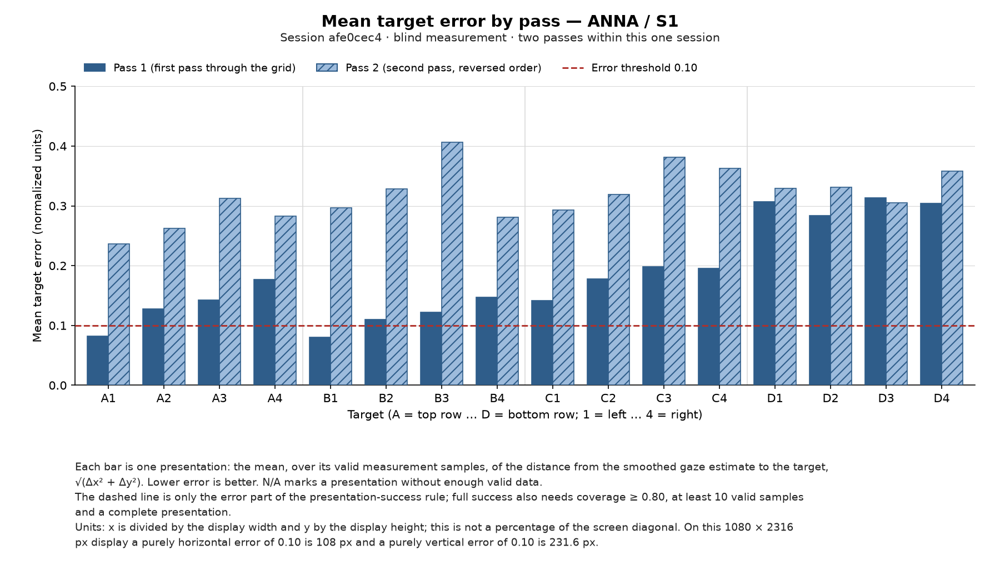
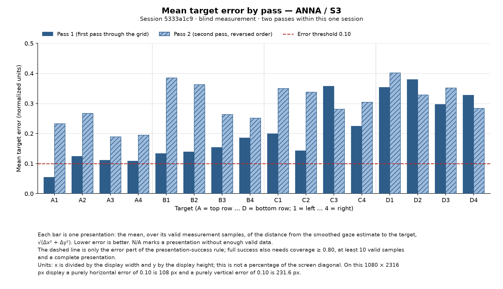

# Figures

Two figures per analyzed session of the home-screen candidate evaluation (protocol 2.0.0, log schema 3). They show
measurements only; the interpretation belongs in the main report ([`../README.md`](../README.md)).

## Sessions shown

| Participant / label | Session ID | Short ID | Start (UTC) |
|---|---|---|---|
| ANNA / S1 | `eval-20261102T025547Z-afe0cec4` | `afe0cec4` | 2026-11-02 02:55:47 |
| ANNA / S3 | `eval-20261102T025951Z-5333a1c9` | `5333a1c9` | 2026-11-02 02:59:51 |

Both are complete blind-measurement runs (32 of 32 presentations), each after its own fresh nine-point calibration,
recorded with build `a8f08696afd3a550bd20c9d4c52fd657123fcdcb` (clean) on a 1080 × 2316 px display, rotation 0.
The labels are the ones recorded on the phone: there is no S2. The interrupted run `eval-20261102T025300Z-a459e68a`
(Back after about 10 s, 4/32 presentations) is excluded. Technical-pilot (`PILOT01`) and synthetic sessions are never
shown. The selection, by session ID, is recorded in
[`../data/analysis-inputs.json`](../data/analysis-inputs.json); full build, protocol and input provenance, the
shared scales and the checksum of every figure are in [`../data/derived/figures-manifest.json`](../data/derived/figures-manifest.json).

## Figure 1: target vs mean estimated gaze

| ANNA / S1 | ANNA / S3 |
|---|---|
| [](anna_s1_afe0cec4_gaze_map.svg) | [](anna_s3_5333a1c9_gaze_map.svg) |

Files: `anna_s1_afe0cec4_gaze_map.svg/.png`, `anna_s3_5333a1c9_gaze_map.svg/.png`.

- The phone screen is drawn to scale (1080 × 2316 px, portrait) in screen coordinates: origin top-left, x to the right,
  y downward. Targets are labelled A1–A4 (top row, left to right) to D1–D4 (bottom row); A1 is protocol target `r0c0`,
  D4 is `r3c3`.
- **Blue crosses** are the 16 targets. **Orange circles** are the mean estimated gaze for each target. **Arrows** go from
  each target to its mean estimate.
- Each target was presented twice (once per pass). For each technically eligible presentation the analyzer computes the
  centroid of its valid measurement samples (mean smoothed x and y). The circle is the plain average of those
  presentation centroids, so each presentation counts equally regardless of how many samples it has.
- Estimates are the candidate's measured coordinate, the smoothed gaze output. It is clamped to the screen by the
  model, so an estimate can sit at an edge but never beyond it.
- A mean position does not show how widely the individual samples were spread around it; Figure 2 does.

## Figure 2: mean target error by pass

| ANNA / S1 | ANNA / S3 |
|---|---|
| [](anna_s1_afe0cec4_target_error.svg) | [](anna_s3_5333a1c9_target_error.svg) |

Files: `anna_s1_afe0cec4_target_error.svg/.png`, `anna_s3_5333a1c9_target_error.svg/.png`.

- Targets A1 … D4 in the same order as Figure 1; two bars per target. **Pass 1** (solid) and **Pass 2** (hatched) are the
  two passes through the grid *within one session* (pass 2 runs in reverse order). They are not the sessions S1 and S3.
- Each bar is the analyzer's presentation mean error: the mean, over the presentation's valid measurement samples, of
  `sqrt((smoothed_x − target_x)² + (smoothed_y − target_y)²)`. Lower is better.
- The dashed line is the predeclared error threshold 0.10. It is only one part of the presentation-success rule, which
  also requires coverage ≥ 0.80, at least 10 valid samples and a complete presentation. Bars are not coloured by success.
- Both sessions use the same y axis, 0 to 0.50, chosen from the largest plotted value of either session (0.406) plus
  headroom; nothing is cropped.
- Units are normalized separately per axis: x by the display width, y by the display height. It is not a percentage of
  the screen diagonal. On this display a purely horizontal error of 0.10 is 108 px and a purely vertical error of 0.10
  is 231.6 px; a mixed error has no single pixel equivalent.

## Centroid displacement is not mean error

The arrow length in Figure 1 is the distance from the target to the *average* position. Errors in opposite directions
cancel in that average: samples spread evenly around a target give a short arrow even when every sample is far from
it. The bars in Figure 2 average each *sample's* distance to the target, so opposite errors do not cancel. A bar is
therefore at least as long as the corresponding presentation's centroid displacement, and the two must not be
compared as the same quantity. Both values are listed in the plot tables
(`centroid_displacement_norm` and `mean_error_norm`).

## Missing data

The figures use the analyzer's technical eligibility (a fully shown presentation with ≥ 10 valid measurement samples
and coverage ≥ 0.5), not the full success rule.

- Figure 1: a target with both presentations eligible shows their average; with one eligible presentation it shows that
  one as a hollow circle and its label reads `(1/2)`; with none it keeps the cross, shows no circle and its label reads
  `(no estimate)`. A missing estimate is never placed at zero or on the target.
- Figure 2: an ineligible presentation keeps its place and shows `N/A` instead of a bar; it is never drawn as a
  zero-height bar.
- In ANNA / S1 and ANNA / S3 all 32 presentations are technically eligible, so neither figure has missing values.

## Inputs and outputs

| What | Where |
|---|---|
| Raw sessions (frozen) | `../data/raw/ANNA/<session_id>/`, checksums in `../data/raw-inputs.sha256` |
| Selection | `../data/analysis-inputs.json` |
| Analyzer output used | `../data/derived/summary.json` (presentation centroids, mean errors, eligibility) |
| Plotted values, per presentation | `../data/derived/figure_presentations.csv` |
| Plotted values, per target | `../data/derived/figure_target_centroids.csv` |
| Provenance, shared scales, figure checksums | `../data/derived/figures-manifest.json` |
| Plotting code | `tools/gaze_eval/gaze_eval_figures.py` (tests: `tools/gaze_eval/test_gaze_eval_figures.py`) |

The plotting code reads the analyzer's results; it does not recompute eligibility, errors or verdicts.

## Regenerating

Tested on Windows with Python 3.14.6, matplotlib 3.11.2 and numpy 2.5.4
([`tools/gaze_eval/requirements-plot.txt`](../../../../tools/gaze_eval/requirements-plot.txt)). Run from the repository
root:

```powershell
python tools/gaze_eval/gaze_eval_data.py check-frozen docs/evaluation/iteration3/data/raw docs/evaluation/iteration3/data/raw-inputs.sha256
python -B tools/gaze_eval/analyze_gaze_eval.py docs/evaluation/iteration3/data/raw --out docs/evaluation/iteration3/data/derived --selection docs/evaluation/iteration3/data/analysis-inputs.json --source-label "ANNA S1 + S3, build a8f08696afd3a550bd20c9d4c52fd657123fcdcb, selection analysis-inputs.json"
python -B tools/gaze_eval/gaze_eval_figures.py --summary docs/evaluation/iteration3/data/derived/summary.json --selection docs/evaluation/iteration3/data/analysis-inputs.json --derived docs/evaluation/iteration3/data/derived --figures docs/evaluation/iteration3/figures
```

The output is deterministic: rerunning with the same inputs and library versions reproduces the same bytes. To add
sessions or participants later, list their session IDs under `included` in `analysis-inputs.json`, re-freeze, and
rerun the three commands; nothing in the plotting code is specific to ANNA or to two sessions.
